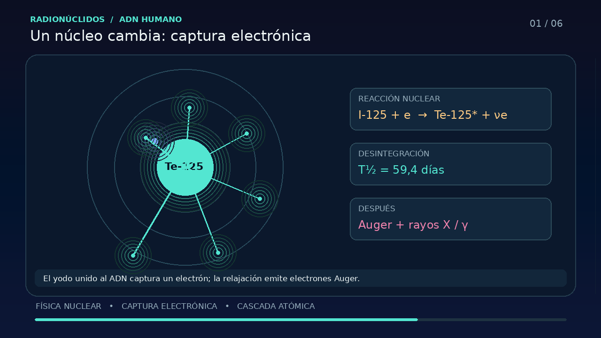
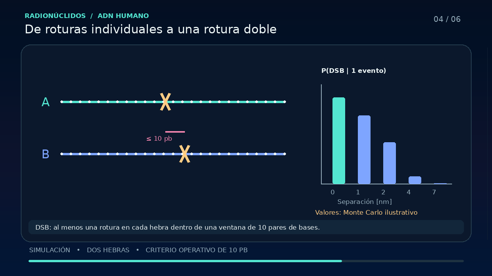
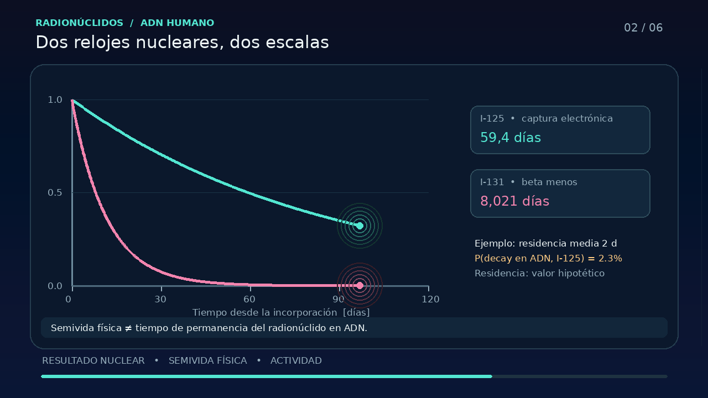
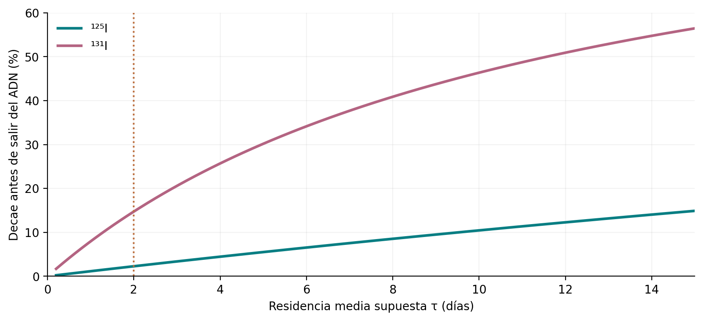
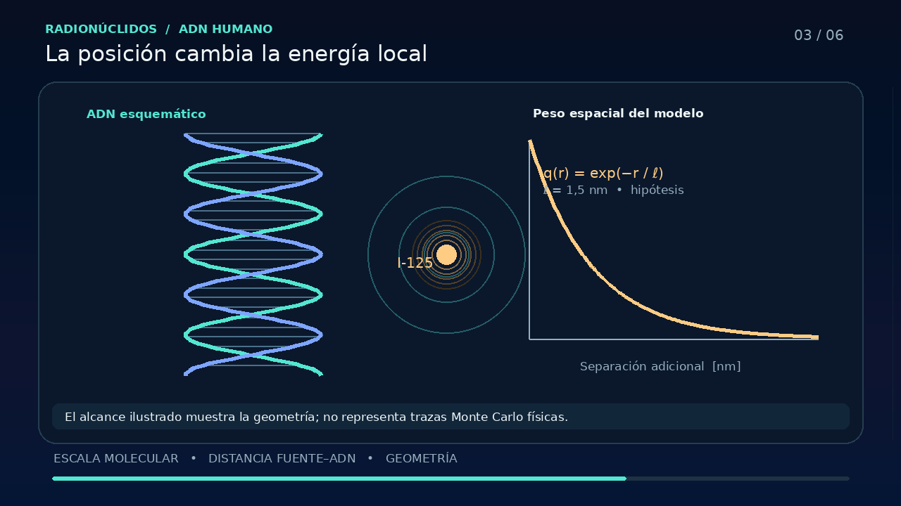
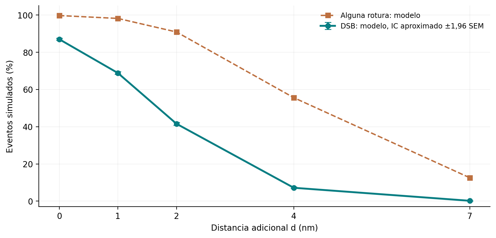
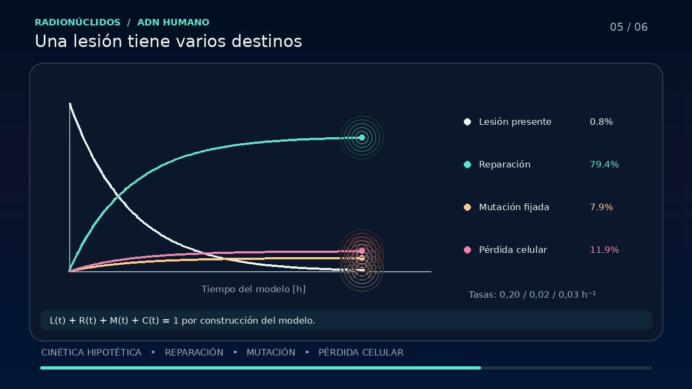
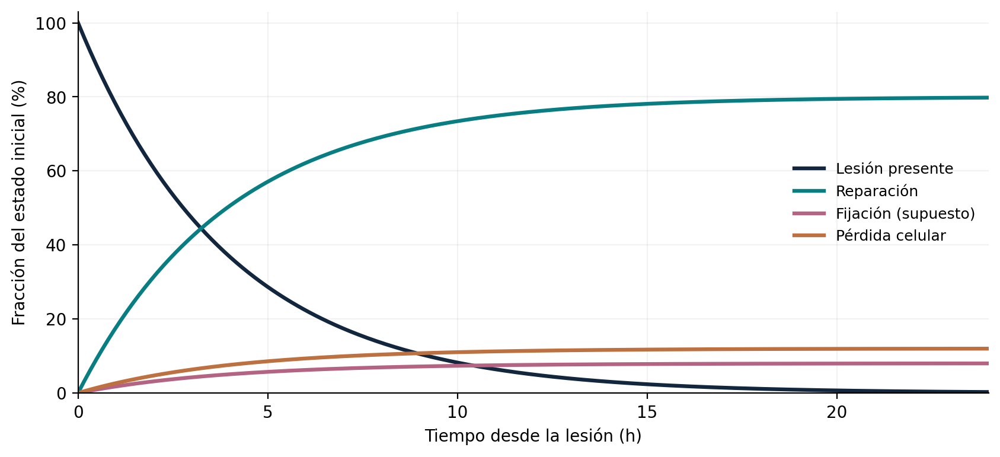
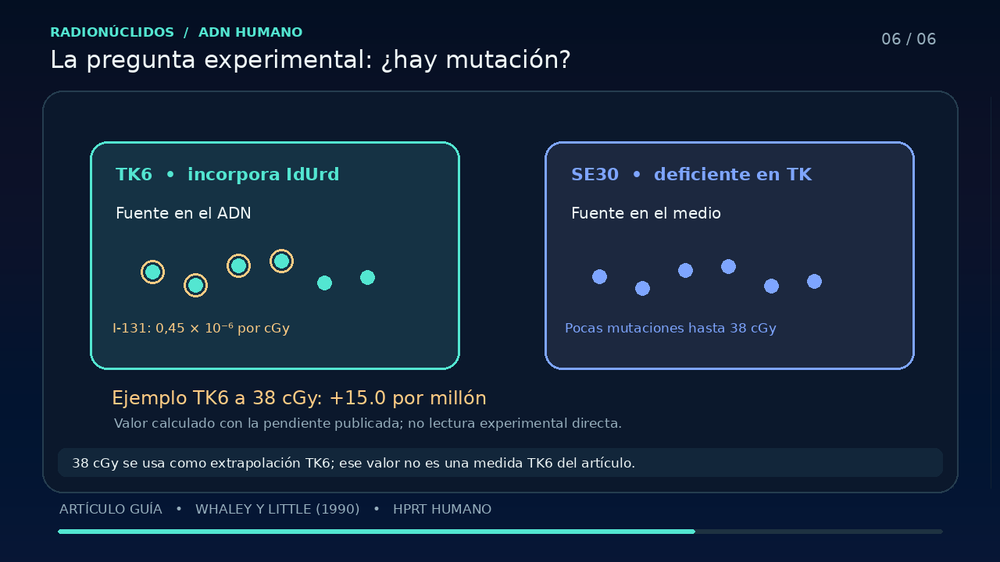
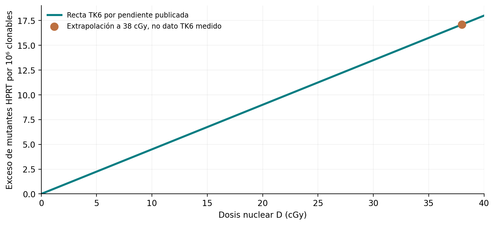

# Cuando un núcleo decae dentro del ADN humano

## De la física subatómica a las lesiones, reparación y mutaciones HPRT

**RADIOGENOMA · MONOGRAFÍA CIENTÍFICA DE ENTREGA**  
**Universidad Nacional de Colombia · Física Subatómica**  
**Equipo:** Proyecto de Física Subatómica  
**Bogotá, Colombia · 25 de noviembre de 2026**

Artículo conductor: Whaley y Little, *Radiation Research* **123** (1990), 68–74 [1].



**Versión:** monografía extensa, seis laboratorios expositivos y anexos de código. El proyecto completo está publicado en [RadioGenoma](https://morganestampadoscol.github.io/radiogenoma-subatomica/) y el [repositorio](https://github.com/MorganEstampadosCol/radiogenoma-subatomica). Las ilustraciones son esquemas; no son micrografías ni registros de pacientes.

# Resumen

El experimento de Whaley y Little [1] estudió muerte celular y mutaciones en el locus *hprt* tras exponer líneas linfoblastoides humanas TK6 y SE30 a iododesoxiuridina marcada con $^{125}\mathrm{I}$ o $^{131}\mathrm{I}$. La diferencia de incorporación al ADN permitió preguntar si importa el lugar donde ocurre una desintegración. Construimos una explicación enlazada desde el proceso nuclear y la semivida hasta la localización de la fuente, la formación simulada de lesiones y el destino de la célula. Contrastamos la pendiente HPRT de $0.45\times10^{-6}$ mutantes inducidos por cGy publicada para $^{131}\mathrm{I}$ en TK6, sin convertirla en riesgo individual ni en tasa de todo el genoma. El proyecto ofrece seis escenas interactivas, seis vídeos, un modelo Monte Carlo reproducible y verificaciones automáticas. La probabilidad de lesión, el tiempo de residencia, las tasas de reparación y el fondo de mutantes son hipótesis declaradas. La principal conclusión experimental es que la incorporación en ADN modifica la eficacia biológica bajo las condiciones de cultivo estudiadas; la simulación explica una posible cadena causal y sus límites.

**Palabras clave:** captura electrónica, electrones Auger, yodo-125, yodo-131, ADN humano, rotura doble, HPRT, Monte Carlo.

# Contenido y ruta de lectura

**Parte I.** Marco científico, artículo guía, derivaciones y límites (13 temas).  
**Parte II.** Seis apartados de exposición, uno por laboratorio y vídeo (01–06).  
**Parte III.** Métodos computacionales, resultados, sensibilidad y control de calidad.  
**Anexos.** Guion oral, glosario, referencias y código íntegro esencial.

Las etiquetas **[DATO]**, **[MODELO]** y **[EXTRAPOLACIÓN]** identifican la procedencia de cada cifra. Una prueba de que el programa funciona demuestra consistencia interna y reproducibilidad, no validez biológica externa.

# Parte I · Fundamento científico y desarrollo matemático

## El problema, su interés y una respuesta comprobable

### Motivación

La actividad radiactiva informa cuántas desintegraciones ocurren por segundo, pero no indica en qué parte de una célula se libera energía. Si un análogo de timidina, la iododesoxiuridina (IdUrd o IUdR), se incorpora al ADN durante la replicación, el átomo de yodo puede quedar próximo a la columna azúcar--fosfato. Si el átomo permanece fuera de la célula, la misma desintegración ocurre a otra distancia. La localización, la energía y la historia de reparación deben distinguirse. Whaley y Little compararon precisamente ambos escenarios en células humanas [1].

La aplicación inmediata es interpretar experimentos con radionúclidos dirigidos al núcleo y diseñar preguntas para radiofármacos. La comparación también enseña por qué una exposición ambiental a yoduro, una fuente de rayos X externa y un análogo de ADN marcado no se pueden declarar equivalentes por el simple hecho de contener radiación. El análisis conecta física nuclear, transporte de energía, biología molecular y lectura crítica de datos.

### Pregunta y objetivos

**Pregunta:** ¿cómo afectan el modo de decaimiento y la distancia fuente--ADN la cadena entre desintegración y mutación HPRT en células humanas, y qué parte de esta cadena permite respaldar el experimento de Whaley y Little?

**Objetivos:** (1) derivar las leyes temporales de ¹²⁵I y ¹³¹I; (2) distinguir captura electrónica, desexcitación atómica y beta menos; (3) estudiar por simulación cómo una hipótesis espacial modifica la probabilidad de una rotura doble; (4) separar lesión, mutación y pérdida celular; (5) calcular una extrapolación *explícita* de la pendiente HPRT publicada; (6) comunicar resultados, supuestos y límites con vídeos y figuras reproducibles.

### Hipótesis y resultado principal

**[DATO] El artículo observa mayores efectos de muerte y mutación cuando la IdUrd marcada se incorpora en ADN que cuando permanece en el medio, bajo sus condiciones de cultivo y sus controles TK6/SE30 [1].** **[MODELO] Nuestra predicción cualitativa es que acercar la fuente a las dos hebras aumenta las lesiones agrupadas si la probabilidad de rotura decrece con la distancia.** Lo segundo es una consecuencia del modelo condicional, no una medición del artículo.

## Artículo guía: diseño, resultados y lectura crítica

**Referencia íntegra:** Whaley, J. M. y Little, J. B., "Efficient mutation induction by ¹²⁵I and ¹³¹I decays in DNA of human cells", *Radiation Research* **123**, 68--74 (1990), DOI [10.2307/3577659](https://doi.org/10.2307/3577659); resumen abierto en [PubMed, PMID 2371380](https://pubmed.ncbi.nlm.nih.gov/2371380/) [1]. El artículo completo puede requerir acceso institucional; los resultados cuantitativos atribuidos aquí están explícitos en su resumen público.

TK6 es competente para la ruta de salvamento de timidina mediada por timidina cinasa (TK). SE30 tiene deficiencia en esa capacidad y permite comparar IdUrd que se incorpora con IdUrd cuya incorporación es deficiente. Se midieron muerte celular y mutantes en el locus *hprt*. No se interpreta la comparación como un experimento de ADN purificado ni se atribuye a SE30 una incorporación estrictamente nula. El propio trabajo examinó explicaciones alternativas como sensibilidad basal distinta a radiación y sensibilización por IdUrd [1].


  Sistema                 Fuente de radiación                               Lectura
  ----------------------- ------------------------------------------------- -------------------------------------------------------------------------
  TK6 + ¹²⁵IIdUrd    Análogo incorporado en ADN                        Efectos tóxicos y mutagénicos pronunciados, cualitativos en el resumen.
  SE30 + ¹²⁵IIdUrd   Incorporación deficiente; actividad en el medio   Prácticamente sin efecto bajo las condiciones descritas en el resumen.
  TK6 + ¹³¹IIdUrd    Análogo incorporado en ADN                        Pendiente HPRT inducida $0.45\times10^{-6}$ mutantes/cGy.
  SE30 + ¹³¹IIdUrd   Actividad en el medio                             Pocas mutaciones para dosis nucleares hasta $38$ cGy.


**Precaución de lectura:** el valor $38$ cGy corresponde al límite de comparación indicado para células deficientes; aplicarlo a la pendiente de TK6 en la sección «Del locus HPRT a un conteo interpretable» es una *extrapolación aritmética*, no un dato TK6 medido a esa dosis. No atribuimos al artículo valores numéricos de roturas dobles por cada desintegración de ¹²⁵I ni una pendiente de mutación para ¹²⁵I que no constan en el resumen.

Como apoyo geométrico, Martin y Haseltine estudiaron una deoxicitidina marcada con ¹²⁵I en una posición definida de un fragmento de ADN: el daño radioquímico se concentró dentro de $15$--$20$ Å ($1.5$--$2\,\mathrm{nm}$) y detectaron roturas hasta $70$ Å ($7\,\mathrm{nm}$) [2]. Estas son distancias de daño en *ese montaje experimental*, distintas del enunciado de Whaley y Little sobre depósito de gran parte de la energía de Auger a menos de $20\,\mathrm{nm}$ del sitio de desintegración [1]. Ni un alcance de electrón ni la distribución de una rotura quedan completamente determinados por una sola longitud.

## Núcleo y curso: de la tasa a la actividad

### Derivación completa de la ley exponencial

Las diapositivas del curso *Decays and scattering* introducen la probabilidad de decaimiento por unidad de tiempo y la densidad de estados. Escribimos $\lambda$ \[día⁻¹\] para la probabilidad instantánea de desintegración por átomo (el símbolo $\Gamma$ de ciertas diapositivas representa la misma tasa cuando su dimensión es tiempo⁻¹) [10]. La probabilidad de sobrevivir a un intervalo $dt$ es $1-\lambda dt+o(dt)$. Por ello, si $N(t)$ es el número medio de núcleos no desintegrados, $$\begin{aligned}
N(t+dt)&=N(t)(1-\lambda dt)+o(dt),\\
N(t+dt)-N(t)&=-\lambda N(t)dt+o(dt),\\
\lim_{dt\to0}\frac{N(t+dt)-N(t)}{dt}&=-\lambda N(t).
\end{aligned}$$ Separamos variables, integramos desde $(0,N_0)$ hasta $(t,N(t))$, y usamos $\int dN/N=\ln N$: $$\begin{aligned}
\frac{dN}{N}&=-\lambda\,dt, &
\int_{N_0}^{N(t)}\frac{dN'}{N'}&=-\lambda\int_0^t dt',\\
\ln\!\frac{N(t)}{N_0}&=-\lambda t, &N(t)&=N_0e^{-\lambda t}.
\end{aligned}$$ La semivida $T_{1/2}$ satisface $N(T_{1/2})=N_0/2$; entonces $1/2=e^{-\lambda T_{1/2}}$, $\ln(1/2)=-\lambda T_{1/2}$ y $$\boxed{\lambda=\frac{\ln2}{T_{1/2}},\qquad \tau=\lambda^{-1}=\frac{T_{1/2}}{\ln2}.}$$ La actividad es el *número positivo de desintegraciones por tiempo*: $A(t)=-dN/dt=\lambda N(t)$, y $1$ Bq $=1$ s⁻¹. Si $\lambda$ se calcula por día, conviértase a s⁻¹ antes de informar actividad en Bq: $\lambda_{\mathrm{s}^{-1}}=\lambda_{\mathrm{día}^{-1}}/86400$. Un signo positivo delante de $dN/dt$ describiría una derivada negativa, no una actividad positiva.

### Ramas de decaimiento y amplitud cuántica

Si existen rutas independientes con tasas $\lambda_k$, en un intervalo $dt$ la probabilidad total es $(\sum_k\lambda_k)dt$. De ahí $\lambda_{\mathrm{total}}=\sum_k\lambda_k$ y la razón de ramificación $b_k=\lambda_k/\lambda_{\mathrm{total}}$, con $\sum b_k=1$. Esto enlaza con la tasa de transición de Fermi $\lambda_{i\to f}\propto |\langle f|V|i\rangle|^2\rho(E_f)$ en las diapositivas [10]. El modelo temporal de supervivencia puede representarse por una amplitud $\psi(t)\propto e^{-iEt/\hbar}e^{-\lambda t/2}$; su módulo al cuadrado da $e^{-\lambda t}$. Aquí $\lambda$ es una tasa temporal; una anchura energética convencional es $\Gamma_E=\hbar\lambda$, que tiene unidades de energía. No igualamos una anchura en eV a una tasa en s⁻¹ sin este factor.

## ¹²⁵I: captura electrónica y cascada Auger

### Conservación de números cuánticos

En la captura electrónica un protón nuclear capta un electrón ligado y se transforma en neutrón: $p+e^-\rightarrow n+\nu_e$ a escala de nucleones. El núcleo tiene $A=125$ antes y después, mientras $Z$ pasa de 53 a 52: ¹²⁵₅₃I + e⁻(ligado) → ¹²⁵₅₂Te* + νₑ. La carga se conserva en el proceso completo; el número leptónico del electrón inicial es $+1$ y el del neutrino saliente también. El estado nuclear excitado de ¹²⁵Te se desexcita principalmente por conversión interna; sólo una fracción minoritaria emite directamente el fotón gamma de $35.49$ keV. IAEA informa $T_{1/2}=59.408$ d, captura electrónica $100\%$, gamma de $35.49$ keV con probabilidad $6.68\%$ y conversión interna aproximadamente $93.32\%$ desde ese estado [6]. Una conversión interna expulsa un electrón atómico usando energía de la transición nuclear: *no* es el electrón previamente capturado.

### Balance de energía, sin simplificar electrones inexistentes

Definimos la diferencia de masas *atómicas neutras* en el estado fundamental como $Q_{EC}=[M_a(\mathrm{I}_{125})-M_a(\mathrm{Te}_{125})]c^2$. Sea $E_*$ la excitación nuclear de ¹²⁵Te, $B_i$ la energía de enlace de la capa de la que se capturó el electrón y $T_R$ la energía de retroceso. A primer orden, despreciando pequeñas correcciones atómicas, $$E_{\nu,i}\simeq Q_{EC}-E_*-B_i-T_R.$$ Explicación de cada sustracción: $E_*$ queda almacenada inicialmente en el núcleo hijo; $B_i$ representa la vacante atómica; $T_R$ es cinética del átomo hijo que garantiza momento conservado. El neutrino y el átomo tienen momentos opuestos a primer orden en un decaimiento de dos cuerpos, de modo que $T_R=p_R^2/(2M_R)$. El valor $35.49$ keV identifica la transición nuclear, *no* es la energía de cada electrón Auger. Una vacante en una capa interna se rellena desde otra capa; la diferencia puede salir como rayo X característico o transferirse a un electrón Auger. Vacantes posteriores generan una cascada. Energías, multiplicidades y destinos requieren un espectro atómico; el código de esta entrega no inventa uno.

### ¿Se queda el núcleo hijo unido al ADN?

La iododesoxiuridina marcada incorpora *el átomo padre* en una molécula del ADN antes del decaimiento. En el instante de captura, el núcleo hijo ¹²⁵Te nace en el mismo lugar inicial, pero *su posición inicial no garantiza que el nuevo elemento permanezca unido*. Cambian el número atómico, la configuración electrónica y los enlaces posibles; la relajación emite electrones y puede originar cambios químicos. Para estimar una escala de retroceso sólo por el neutrino, si su energía fuera $0.12$ MeV y se despreciara su masa, $p_\nu c\simeq0.12$ MeV. Con $M_Rc^2\simeq125(931.5)$ MeV, $$T_R\simeq\frac{(p_\nu c)^2}{2M_Rc^2}=\frac{(0.12\,\mathrm{MeV})^2}{2(125)(931.5\,\mathrm{MeV})}\simeq6.18\times10^{-8}\,\mathrm{MeV}\simeq0.062\,\mathrm{eV}.$$ Los $0.12$ MeV son un *ejemplo de neutrino supuesto*; la energía real depende de la capa capturada y el estado final según la ecuación del balance de energía anterior. Aun si el retroceso nuclear en este ejemplo es pequeño, no permite concluir la estabilidad de la unión química tras la transmutación y la ionización múltiple. Para hablar de daño local basta que la fuente estuviera allí *cuando* se produjo la cascada; nuestro modelo no simula el destino posterior del Te. En beta menos de ¹³¹I el producto es xenón: tampoco se conserva por definición el mismo enlace químico después de transformarse en otro elemento.

### Tiempo físico

Usamos $T_{1/2}=59.4$ d redondeado para reproducir la animación. La tasa por día es $\lambda_{125}=\ln2/59.4=0.011669\,\mathrm{d}^{-1}$ aproximadamente. Si un millón de núcleos permanecen localizados durante 1 día sin pérdida biológica, el número *medio* de desintegraciones es $10^6(1-e^{-0.011669})\simeq11\,601$. No todos los núcleos de una administración real quedan en el ADN ni siguen esta permanencia ideal.

## ¹³¹I: beta menos y un espectro continuo

El mecanismo nuclear es $n\to p+e^-+\bar\nu_e$, que aumenta $Z$ de 53 a 54 y conserva $A=131$: $${}^{131}_{53}\mathrm I\longrightarrow{}^{131}_{54}\mathrm{Xe}^*+e^-+\bar\nu_e .$$ Para una rama hacia una excitación hija $E_*$, definimos $Q_\beta=[M_a(\mathrm{I}_{131})-M_a(\mathrm{Xe}_{131})]c^2$ con masas atómicas neutras y $Q_b=Q_\beta-E_*$. Despreciando retroceso en un primer esquema, $$\begin{aligned}
Q_b&=T_e+E_{\bar\nu}+T_R,\\ E_{\bar\nu}&\simeq Q_b-T_e-T_R,\qquad 0\leq T_e\lesssim Q_b.
\end{aligned}$$ El electrón no tiene energía fija porque el antineutrino participa en el reparto. Para una transición permitida ideal, la dependencia *esquemática* es $$\frac{dN_b}{dT_e}\propto F(Z_f,T_e)\,p_e(T_e)\,\bigl(T_e+m_ec^2\bigr)\,(Q_b-T_e)^2\,C_b(T_e),\quad p_ec=\sqrt{T_e(T_e+2m_ec^2)}.$$ Aquí $F$ corrige la interacción coulombiana, $C_b$ incorpora forma y reglas de transición, y $b$ es una rama nuclear concreta. El espectro completo sería la suma ponderada $dN/dT_e=\sum_b b_b(dN_b/dT_e)$; no se declara que la fórmula simplificada dé el espectro real completo de ¹³¹I. Su semivida es $8.021$ d según ICRP [7]; la emisión gamma principal próxima a $364.5$ keV y la rama beta con extremo próximo a $606$ keV se documentan para este isótopo en IAEA [8]. $606$ keV es energía *máxima de una rama*, no energía única ni energía media.

La existencia de un electrón de mayor recorrido no implica igual probabilidad de daño por desintegración incorporada: localización, cascadas secundarias y geometría importan. La diapositiva de detección del curso discute pérdida de energía y alcance; sus ejemplos de pico de Bragg para hadrones no se transfieren sin más a los electrones beta, sujetos a dispersión y múltiples interacciones [11].

## Un átomo puede abandonar el ADN antes de decaer

Sea $n(t)$ la población media de átomos aún en ADN. Además del decaimiento con tasa $\lambda$, supongamos *como hipótesis* una salida exponencial con tasa biológica $k$ \[día⁻¹\]. En $dt$, ambas vías son eventos competitivos: $dn=-(\lambda+k)n\,dt$, por lo que $$n(t)=n_0e^{-(\lambda+k)t}.$$ Las desintegraciones *dentro del ADN* durante $dt$ son $dD_{ADN}=\lambda n(t)dt$. Integrando desde 0 hasta $t$: $$\begin{aligned}
D_{ADN}(t)&=\int_0^t\lambda n_0e^{-(\lambda+k)s}\,ds\\
&=\lambda n_0\left[\frac{-e^{-(\lambda+k)s}}{\lambda+k}\right]_0^t\\
&=n_0\frac{\lambda}{\lambda+k}\left(1-e^{-(\lambda+k)t}\right).
\end{aligned}$$ Dividiendo por $n_0$ se obtiene $P(D_{ADN}\text{ antes de }t)$. Si $t\to\infty$, el término exponencial tiende a cero, y $P=\lambda/(\lambda+k)$. Sea $\tau_b$ el tiempo medio de residencia: $k=1/\tau_b$, *no* $\ln2/\tau_b$. Con la hipótesis $\tau_b=2$ d, $k=0.5$ d⁻¹ y las tasas anteriores, obtenemos $P_{125}=0.0228$ y $P_{131}=0.1474$ aproximadamente. Estos porcentajes *no* describen la biocinética de las células del artículo: ilustran el peso de una tasa competidora. **Chequeo:** $k=0$ da $P=1$; $\lambda\to0$ con $k>0$ da $P\to0$.

## Geometría del ADN y modelo explícito de daño

### Escala y coordenadas

Para una sección ideal de $n=60$ pares de bases usamos radio de columna $R=1.0$ nm y avance axial $h=0.34$ nm por par (vuelta aproximada de 10 pb = 3.4 nm). Estas cifras fijan una *hélice ilustrativa*, no la estructura atomística de un locus HPRT. Definimos $j=0,\ldots,n-1$, $j_c=\lfloor n/2\rfloor$ y $\theta_j=2\pi(j-j_c)/10$. Las dos columnas son $$\mathbf x_{A,j}=(R\cos\theta_j,R\sin\theta_j,h(j-j_c)),\qquad
\mathbf x_{B,j}=(-R\cos\theta_j,-R\sin\theta_j,h(j-j_c)).$$ La fuente se ubica en $\mathbf s=(R+d,0,0)$: $d=0$ corresponde al borde de la hebra A en el par central, y $d>0$ mueve la fuente hacia afuera. La distancia euclidiana de fuente a cada sitio es $r_{X,j}=\|\mathbf x_{X,j}-\mathbf s\|$, para $X\in\{A,B\}$. *No* se sustituyen pares de bases por nanómetros sin la conversión $h=0.34\,\mathrm{nm}/\mathrm{pb}$, y para pares opuestos a igual $j$ queda además separación transversal.

### De un peso espacial a una Bernoulli de rotura

Introducimos el peso *fenomenológico* $q_{X,j}=\exp(-r_{X,j}/\ell)$, donde $\ell=1.5$ nm es un parámetro *elegido para explorar*, no ajustado al alcance observado en Martin y Haseltine. Supongamos oportunidades de lesión locales Poisson de media $\mu q_{X,j}$, con $\mu=0.48$ como escenario. La probabilidad de *cero* oportunidades es $\exp(-\mu q_{X,j})$. Por complemento, la probabilidad de al menos una rotura del sitio es $$\boxed{p_{X,j}=1-\exp[-\mu\exp(-r_{X,j}/\ell)].}$$ Cada evento simulado genera una variable uniforme $U_{X,j}\sim\mathcal U(0,1)$ y marca rotura si $U_{X,j}<p_{X,j}$. Las Bernoulli se tratan como independientes *condicionadas a* $d,\mu,\ell$. Una cascada real tiene correlaciones entre electrones y química acuosa; la independencia es un límite del modelo. No se asigna a cada oportunidad una energía en eV ni se convierte la expresión en un espectro Auger.

### Criterio DSB y estimación Monte Carlo

La regla operativa usada aquí llama "DSB" a la existencia de dos roturas, una en A y otra en B, con $|j_A-j_B|\leq10$ pb. La ventana de 10 pb es una *convención algorítmica declarada*; variarla cambia la clasificación. Para $N_{MC}$ eventos independientes con indicador $I_m(d)\in\{0,1\}$: $$\widehat p_{DSB}(d)=\frac{1}{N_{MC}}\sum_{m=1}^{N_{MC}}I_m(d),\qquad
\widehat{\mathrm{SEM}}=\sqrt{\frac{\widehat p(1-\widehat p)}{N_{MC}}}.$$ El error estándar binomial estima *variación de muestreo con parámetros fijos*. No incluye incertidumbre sobre $\ell$, $\mu$, la geometría o los mecanismos de reparación. Se emplea una semilla fija (2026) y números aleatorios comunes por escenario $d$, lo que facilita reproducir diferencias. Cada evento está condicionado a una desintegración en una posición elegida: $\widehat p_{DSB}$ *no* es frecuencia medida de DSB por decaimiento del artículo.

### Control analítico: rotura en cualquier sitio

Antes de estudiar las parejas DSB, existe una prueba cerrada del simulador. Denotemos por $B_{X,j}=0$ que el sitio no se rompió. Como las variables Bernoulli son independientes *dentro de esta hipótesis*, la probabilidad de ninguna rotura en ningún sitio es el producto de todas las probabilidades complementarias: $$\begin{aligned}
P(\text{sin roturas})&=\prod_{X\in\{A,B\}}\prod_{j=0}^{59}(1-p_{X,j})\\
&=\prod_{X,j}\exp[-\mu\exp(-r_{X,j}/\ell)]\\
&=\exp\left[-\mu\sum_{X,j}\exp(-r_{X,j}/\ell)\right].
\end{aligned}$$ Pasamos de producto a exponencial de suma porque $\prod e^{a_j}=e^{\sum a_j}$; tomando el complemento se obtiene $P(\text{alguna rotura})=1-\exp[-\mu\sum_{X,j}q_{X,j}]$. Con la fuente en $d=0$, la fórmula da $0.99693$ y el código obtuvo $0.99713$ en $15\,000$ eventos: la diferencia $0.00020$ es pequeña frente a su error binomial aproximado. Esto verifica el muestreo de roturas individuales *según el modelo*, no valida la biofísica de los electrones reales.

Una pareja opuesta concreta $(i,j)$, con $|i-j|\leq10$, tiene probabilidad $p_{A,i}p_{B,j}$ bajo la misma independencia. Al sumar esas probabilidades se obtiene el *número medio de parejas*, no la probabilidad de al menos una DSB: un evento puede contener varias parejas. La desigualdad de la unión sólo asegura $P(DSB)\leq\sum_{|i-j|\leq10}p_{A,i}p_{B,j}$. Esta distinción explica por qué el algoritmo usa la función indicadora "existe alguna pareja", en vez de sumar cuentas de parejas como si fueran eventos separados.

### Resultados del escenario base y sensibilidad

Los resultados de referencia en `documentacion/resumen_modelo.json` para $N_{MC}=15\,000$, $\mu=0.48$, $\ell=1.5$ nm, semilla 2026, son:
| d (nm) | P(cualquier rotura) | P(DSB) | SEM |
|---:|---:|---:|---:|
| 0 | 0,99713 | 0,87000 | 0,00275 |
| 1 | 0,98167 | 0,68847 | 0,00378 |
| 2 | 0,90880 | 0,41560 | 0,00402 |
| 4 | 0,55587 | 0,07180 | 0,00211 |
| 7 | 0,12580 | 0,00200 | 0,00036 |


El error de muestreo al 95% se aproximaría por $\widehat p\pm1.96\,SEM$ cuando la aproximación normal es adecuada; para probabilidades cercanas a cero conviene un intervalo binomial exacto o de Wilson. Ninguno de estos intervalos cubriría automáticamente la incertidumbre de $\ell$ y $\mu$.

Hicimos un barrido intencional de *hipótesis*, con $6\,000$ eventos por punto y la misma semilla. A $d=0$, si $\mu$ baja a $0.24$, $\widehat P(DSB)=0.531$; si sube a $0.96$, pasa a $0.993$. Con $\mu=0.48$ y $\ell=1.0$ nm, resulta $0.593$; con $\ell=2.0$ nm, $0.963$. En $d=4$ nm esas mismas alternativas producen $0.0217$, $0.2147$, $0.0032$ y $0.3003$, respectivamente. La variación excede por mucho los errores de muestreo: el modelo no fija una probabilidad biológica universal. El patrón *dentro de cada escenario* es que la fuente más cercana da más parejas de roturas; la magnitud debe establecerse experimentalmente o con transporte microscópico validado.

{width=".92\\textwidth"}

### De energía a dosis: qué representa un gray

La energía absorbida $E_{abs}$ dividida por una masa $m$ define $D=E_{abs}/m$ y $1\,\mathrm{Gy}=1\,\mathrm{J\,kg^{-1}}$. Para un volumen de agua ideal esférico, $m=\rho(4\pi/3)r^3$. Si *hipotéticamente* se depositara $1$ keV entero en una esfera de agua de radio $2$ nm, se obtendría $E=10^3(1.602176634\times10^{-19})=1.602176634\times10^{-16}$ J, $m=(10^3\,\mathrm{kg\,m^{-3}})(4\pi/3)(2\times10^{-9}\,\mathrm m)^3=3.3510\times10^{-23}$ kg y $D\simeq4.78\times10^6$ Gy para *esa masa y ese único evento supuesto*. Ese valor no es una dosis terapéutica, no significa que un electrón real deposite íntegramente 1 keV ahí, y no se compara con una dosis celular promedio sin especificar el volumen y el reparto de energía. Precisamente muestra por qué la escala del volumen debe escribirse cuando se calcula un gray.

## Después del daño: tres destinos que compiten

Sea $L(t)$ la fracción de lesiones aún presentes y $R(t)$, $M(t)$, $C(t)$ las fracciones acumuladas que ya han pasado a reparación, mutación fijada y pérdida celular. El tiempo está en horas y las tasas *hipotéticas* $k_r=0.20$, $k_m=0.02$, $k_c=0.03$ h⁻¹. Este $k_m$ es *otro parámetro* distinto de la pendiente de mutación observada en HPRT. Con $K=k_r+k_m+k_c=0.25$ h⁻¹: $$\frac{dL}{dt}=-KL,\qquad L(0)=1.$$

$$\frac{dR}{dt}=k_rL,\qquad \frac{dM}{dt}=k_mL,\qquad \frac{dC}{dt}=k_cL.$$ Integramos: $L(t)=e^{-Kt}$ y $R(t)=k_r\int_0^t e^{-Ks}ds=(k_r/K)(1-e^{-Kt})$; sustituyendo $k_r$ por $k_m,k_c$ obtenemos $M(t),C(t)$. Sumando, $$L+R+M+C=e^{-Kt}+\frac{k_r+k_m+k_c}{K}(1-e^{-Kt})=1.$$ En el límite $t\to\infty$ el destino simulado se reparte $80\%$, $8\%$, $12\%$. Son fracciones *asumidas por las tasas*, no prevalencias reales de lesiones ni una calibración humana. "Mutación fijada" exige supervivencia y cambios heredables en descendientes celulares: la animación representa la distinción, no reemplaza experimentos de linaje y secuenciación.

## Del locus HPRT a un conteo interpretable {#sec:hprt}

Una rotura observada en ADN no demuestra una mutación heredable; una mutación HPRT se evalúa con una selección y la frecuencia de mutantes entre células clonables. El experimento del artículo registra mutantes en el locus *hprt* y distingue la muerte celular de esta variable [1]. **Dos enzimas, dos funciones:** la timidina cinasa (TK) controla la incorporación del análogo IdUrd; la hipoxantina--guanina fosforribosiltransferasa (HPRT) participa en la vía de rescate de purinas y permite seleccionar células resistentes a 6-tioguanina cuando se pierde la función correspondiente. TK6 y SE30 comparan la primera ruta; la medición de mutantes HPRT explora otro locus. No sería correcto afirmar que "SE30 tiene mutado HPRT" por ser deficiente en TK. HPRT1 humano se encuentra en el cromosoma X [5]; O'Neill, Sullivan y Albertini describieron un ensayo de clonación con 6-tioguanina y corrección por capacidad de clonación en células humanas [4]. Este apoyo metodológico no demuestra que el procedimiento exacto de cultivo de Whaley y Little usara idénticas concentraciones o tiempos.

Si $n$ células se siembran por pocillo y cada célula tiene probabilidad efectiva $f\,\varepsilon$ de producir un clon resistente, donde $f$ es la frecuencia de mutantes y $\varepsilon$ es su eficiencia de clonación bajo selección, entonces para eventos raros la cantidad de clones resistentes por pocillo se modela como Poisson con media $nf\varepsilon$. La probabilidad de un pocillo sin clon es $P_0=e^{-nf\varepsilon}$. Aplicando logaritmo a ambos lados: $\ln P_0=-nf\varepsilon$, de donde $$\boxed{f=-\frac{\ln P_0}{n\varepsilon}.}$$ Esta expresión ilustra por qué contar sólo pocillos positivos no basta: deben conocerse el número sembrado y la eficiencia de clonación, y debe permitirse expresión fenotípica. El programa de esta entrega parte *ya* de un número de células clonables y usa Poisson para ilustrar repeticiones; no reconstruye los datos crudos del artículo.

Para modelar un conteo simplificado con $n$ células clonables y frecuencia de fondo $f_0$, usamos $$f_{TK6}(D)=f_0+\alpha D,\qquad \alpha=0.45\times10^{-6}\,\mathrm{cGy}^{-1},\qquad D\ \text{en cGy}.$$ La pendiente $\alpha$ corresponde a ¹³¹IIdUrd en TK6 del artículo; el fondo $f_0$ no está informado aquí y en la simulación se *elige* $10\times10^{-6}$. El exceso de frecuencia a $D=38$ cGy es $$\Delta f=\alpha D=(0.45\times10^{-6}\,\mathrm{cGy}^{-1})(38\,\mathrm{cGy})=17.1\times10^{-6}.$$

Esto equivale a 17,1 mutantes inducidos por millón de células clonables. Además, $38\,\mathrm{cGy}=0.38\,\mathrm{Gy}$ y $\alpha=45\times10^{-6}\,\mathrm{Gy}^{-1}$. Se cambió la unidad porque $1$ Gy $=100$ cGy; para mantener $\alpha D$ idéntico, el valor numérico de $\alpha$ por Gy se multiplica por $100$. La cifra $17.1$ es una **extrapolación de TK6** en un nivel de dosis mencionado para SE30, no una medición directa de TK6 a 38 cGy y tampoco una tasa de mutación del genoma completo. El modelo opcional de réplicas toma $Y_0\sim\mathrm{Poisson}(nf_0)$ y $Y_D\sim\mathrm{Poisson}(n(f_0+\alpha D))$; por independencia, $E[Y_D-Y_0]=n\alpha D$ y $\mathrm{Var}(Y_D-Y_0)=n(2f_0+\alpha D)$. El número de células *clonables* se presupone, no se infiere de supervivencia.

## Resultados reproducibles y lectura de las seis animaciones

Desde la raíz del repositorio, ejecutar `python python/modelo.py` produce `resultados/resumen_modelo.json`. Ejecutar `python python/animar.py` produce seis MP4 de 1280 × 720 a 20 fps, un vídeo unido y seis portadas PNG. Cada vídeo dura aproximadamente 7 s; se recomienda pausar el vídeo y explicar la variable indicada. Los cuadros ilustran mecanismos, no una filmación real ni trayectorias calculadas con Geant4.

  Escena               Lo que cambia realmente                                                                                  Qué explicar frente al público
  -------------------- -------------------------------------------------------------------------------------------------------- ------------------------------------------------------------------------------------------------------------------------------
  01 Captura y Auger   Representación de I-125 a Te-125 con vacante y cascada.                                                  Conservación de $A$ y $Z$, captura de electrón ligado, excitación y Auger; el movimiento audiovisual no es un tiempo físico.
  02 Semividas         $N/N_0=e^{-\lambda t}$; ejemplo de salida con $k=0.5$ d⁻¹.                                          Dos escalas temporales, fracción que decae antes de salir, diferencia entre $T_{1/2}$ y residencia.
  03 Distancia         $q(r)=e^{-r/\ell}$, con $\ell=1.5$ nm hipotético.                                                        El perfil sirve al modelo; no es el alcance medido de un electrón ni una curva experimental.
  04 Dos hebras        Simulación de de la probabilidad por sitio y ventana de 10 pb.   Rotura simple frente a rotura doble; frecuencia condicional y error de muestreo.
  05 Destinos          $L,R,M,C$ con suma unitaria.                                                                             Daño, reparación, fijación y pérdida son variables distintas; tasas ilustrativas.
  06 HPRT humano       TK6/SE30, pendiente publicada de I-131.                                                                  ¿Qué se midió? ¿Qué se extrapoló? ¿Qué no se puede inferir sobre una persona?

## Vínculo preciso con el programa

Las diapositivas proporcionadas de *Decays and scattering* tratan estados inestables, tasa, semivida, actividad, modos y razón de ramificación: aparecen en las secciones 3--5 [10]. La presentación *Particle Detection--part 2* introduce pérdida de energía y alcance de partículas en materia: motiva nuestra discusión sobre deposición de energía y límites de un modelo de electrones [11]. La física de interacciones débiles aparece en la transformación nuclear beta/captura, mientras la relajación electromagnética permite distinguir rayos X, gamma y Auger. No se usan QCD, modelo de capas, Proca o diagramas de Feynman como adornos: no son necesarios para responder esta pregunta. El ensayo HPRT entra como medición biológica posterior y no sustituye una medida de energía de detector.

## Utilidad, analogías prudentes y limitaciones

**Utilidad científica:** seleccionar blancos subcelulares para estudiar emisores Auger; priorizar medidas de incorporación, distribución y permanencia antes de convertir Bq en efecto; distinguir un biomarcador de daño (roturas) de un desenlace tardío (mutación). **Símil de actualidad:** una radioterapia con radiofármaco dirigido al núcleo exige saber dónde queda cada fuente; las exposiciones por accidentes nucleares requieren otras vías de entrada, metabolismo y distribución. Los resultados de IdUrd en cultivo no cuantifican las consecuencias sanitarias de Chernóbil, bombas atómicas o radioyodo convencional, ni se extrapolan a personas sin datos de órganos y dosis.

**Límites del estudio:** (i) las líneas celulares humanas no son una cohorte de pacientes; (ii) la actividad y la dosis al núcleo no identifican por sí solas una secuencia genómica mutada; (iii) la hélice representada contiene 60 pb ideales, no el genoma humano; (iv) el modelo espacial usa un núcleo de probabilidad elegido, independencia de sitios y un criterio operacional DSB; (v) la tasa de residencia, las tasas celulares y el fondo HPRT del código son escenarios; (vi) los vídeos muestran un relato de mecanismos y no mediciones en tiempo real. El experimento de LeMotte y Little encontró aproximadamente una rotura doble por desintegración ¹²⁵I bajo condiciones congeladas [3]; *esa* medida no valida las probabilidades numéricas de nuestro código para una hélice aislada. La corrección de Schmitz y colaboradores subrayó además que una rotura doble no se convierte automáticamente en aberración cromosómica: sus datos revisados dieron en promedio unas 250 desintegraciones por aberración bajo sus condiciones experimentales [9].

## Conclusión defendible

Las ecuaciones nucleares y la ley de decaimiento describen *cuándo y qué* se emite. La geometría y la permanencia modifican *dónde* se deposita energía. Reparación, supervivencia y selección experimental determinan *qué efecto final se observa*. En cultivos humanos TK6/SE30, Whaley y Little encontraron una diferencia clara entre radionúclidos incorporados y actividad extracelular [1]. Nuestro modelo muestra una vía consistente para pensar esa diferencia y expone los datos necesarios para verificarla con mayor fidelidad, sin reclamar una predicción clínica o genómica que los datos no sustentan.


# Parte II · Seis apartados para exponer el trabajo

Cada apartado corresponde a una página interactiva y un vídeo corto. En la exposición, el vídeo introduce la idea y los controles permiten probar una pregunta. La duración audiovisual no representa tiempo físico. Es recomendable desarrollar con calma los apartados 04 y 06: son los que muestran con mayor claridad la transición desde la biología del ADN hasta un resultado experimental.

## 01 · Captura electrónica y cascada Auger


**Pregunta al público.** «Si el yodo está en una molécula del ADN, ¿qué cambia cuando su núcleo se transforma?» La escena empieza con ¹²⁵₅₃I + e⁻ → ¹²⁵₅₂Te* + νₑ. Dibuje 53 protones antes y 52 después; la suma de nucleones sigue siendo 125. En la pizarra, una captura de un electrón ligado crea una vacante atómica, mientras el núcleo hijo excitado puede desexcitarse. La transferencia de energía de una transición nuclear por conversión interna y la relajación de vacantes por rayos X o electrones Auger no son el mismo paso, aunque una secuencia pueda producir ambos [6].

**Demostración de pantalla.** Abra `01-captura-auger.html`. Mueva únicamente «Velocidad visual» (0,5–2,5×) y pulse «Repetir desintegración». El valor modifica la reproducción, no $\lambda$, la energía ni el número real de emisiones. Señale el neutrino, el núcleo transformado y la cascada. Pregunte dónde se produciría el daño si el padre se encontraba fuera de la célula. **Mensaje comprobable:** el artículo [1] describe el depósito de gran parte de la energía Auger dentro de 20 nm del sitio de desintegración; no afirma que todos los electrones recorran 20 nm exactamente.

**Explicación biológica.** La iododesoxiuridina es un análogo de timidina. En células que la incorporan, el átomo padre puede ocupar una posición próxima a la estructura del ADN. Al decaer nace Te en ese lugar inicial, pero el nuevo elemento no conserva necesariamente el enlace químico. El vídeo ilustra un origen local; no calcula química de radicales, trayectorias ni espectros. Cierre preguntando «¿cuánto debe esperar un átomo hasta decaer?», que enlaza con la escena 02.

## 02 · Semividas y competencia con la salida del ADN



**Derivación en tres líneas.** Para una tasa instantánea constante, $dN/dt=-\lambda N$; integrar da $N(t)=N_0e^{-\lambda t}$ y $\lambda=\ln 2/T_{1/2}$. Las semividas tabuladas son 59,40 días para $^{125}\mathrm{I}$ y 8,021 días para $^{131}\mathrm{I}$ [7]. La actividad $A=\lambda N$ se expresa en Bq tras convertir la tasa a segundos. La semivida es una propiedad nuclear; la permanencia en ADN depende de procesos celulares no inferibles de ella.

**Modelo competidor.** Si salir del ADN tiene riesgo constante $k=1/\tau_b$, entonces $n(t)=n_0e^{-(\lambda+k)t}$ y la fracción inicial que decae antes de salir hasta $t$ es $\lambda(1-e^{-(\lambda+k)t})/(\lambda+k)$. Para $t\to\infty$, vale $\lambda/(\lambda+k)$. Con $\tau_b=2$ días **supuestos**, da 2,28 % para $^{125}\mathrm{I}$ y 14,74 % para $^{131}\mathrm{I}$; no son fracciones medidas en TK6 [7]. La mayor probabilidad de decaer antes de salir en el segundo caso no significa por sí sola mayor efecto por desintegración.

**Demostración.** Abra `02-semividas-retencion.html`. Mueva el tiempo transcurrido entre 0 y 120 días: cambian dos curvas $N/N_0$. Mueva residencia media entre 0,5 y 15 días: cambia la fracción calculada antes de la salida, no las semividas. Haga comprobar el límite $k=0$ en la derivación: si no hay salida, todo átomo acaba decayendo allí en este modelo. La pregunta siguiente es «si decae en el ADN, ¿a qué distancia de cada hebra está?».



## 03 · Distancia fuente–ADN y probabilidad de lesión



**Escala geométrica.** Sitúe una hélice ideal de 60 pares de bases con radio $R=1$ nm, incremento axial $h=0.34$ nm/pb y diez pb por vuelta. Para $j=0,\dots,59$, defina $\theta_j=2\pi(j-30)/10$ y $z_j=h(j-30)$. Las columnas se colocan en $(R\cos\theta_j,R\sin\theta_j,z_j)$ y $(-R\cos\theta_j,-R\sin\theta_j,z_j)$. La fuente se fija en $(R+d,0,0)$. Para $d=0$ coincide con el sitio central de la primera hebra; una fuente en el exterior a $d=4$ nm cambia todas las distancias $r_{X,j}$.

**Hipótesis espacial.** El perfil $q(r)=e^{-r/\ell}$ es un peso elegido. Si las oportunidades locales de daño fueran Poisson de media $\mu q(r)$, la probabilidad de una o más sería $p=1-e^{-\mu e^{-r/\ell}}$. Con $\mu=0.48$ y $\ell=1.5$ nm se ilustra la caída con distancia. $ℓ$ no es una longitud de recorrido único de electrones. Martin y Haseltine encontraron la mayor parte del daño en 15–20 Å y roturas detectables hasta 70 Å en un fragmento experimental diferente [2]; no se ajustó la curva a esos datos.

**Demostración.** Abra `03-distancia-adn.html`. Mueva $d$ (0–7 nm) manteniendo $\mu$ y $\ell$ fijos. Luego mueva $\mu$ (0,12–0,96) y $\ell$ (1–2,5 nm) por separado. La cifra superior es una frecuencia Monte Carlo del modelo, con 3500 ensayos en navegador; no es una observación de laboratorio. Pregunte por qué dos sitios de igual índice pueden tener distinta distancia a la fuente. La respuesta está en el desplazamiento transversal de las hebras. El apartado 04 convierte estas probabilidades en roturas agrupadas.

## 04 · Roturas agrupadas: del ADN lesionado a una DSB operativa


**Experimento virtual, paso a paso.** (1) Para cada una de las 120 posiciones (60 por hebra), calcule $r_j$ y $p_j$. (2) Genere un uniforme $U_j$ entre 0 y 1; marque rotura si $U_j<p_j$. (3) Busque una rotura $i$ en A y una $j$ en B con $|i-j|\leq10$ pb. (4) Registre 1 si existe al menos una pareja, o 0 si no. (5) Repita 15 000 veces en Python y estime $\widehat p=\sum I_k/n$. Se cuentan **eventos con al menos una pareja**; un evento con tres parejas no se cuenta tres veces. El umbral de diez pb es una definición operacional para esta demostración, no un diagnóstico de lesión molecular medido [1,2].

**Ejemplo para la pizarra.** Si A se rompe en 20 y B en 30, $|20-30|=10$: la regla puntúa DSB. Si B se rompe en 31, $|20-31|=11$: no puntúa. Si hay dos roturas en A y ninguna en B, tampoco puntúa. En `04-roturas-agrupadas.html`, pulse «Generar otra desintegración»: verá otra muestra individual. La cifra «P(DSB) Monte Carlo» recoge un conjunto de 3500 muestras con los controles actuales; un solo dibujo no es ese porcentaje. Con $d=0$, $\mu=0.48$ y $\ell=1.5$ nm, Python reporta $0.8700\pm0.00275$ (un error estándar) para 15 000 eventos. A $d=4$ nm reporta $0.07180\pm0.00211$.

**Explicación biológica.** Una lesión agrupada puede ser más difícil de resolver que una lesión aislada, pero el simulador no incluye química del agua, topología de cromatina, reparación real ni correlaciones de depósitos energéticos. Su independencia Bernoulli condicionada a la fuente fija es una simplificación fuerte. Martin y Haseltine [2] sirven para motivar proximidad; no calibran $\mu$, $\ell$ ni la cifra $0.87$. Una DSB tampoco equivale a mutación. Pase a la escena 05 preguntando qué puede hacer la célula con el daño.



## 05 · Reparación, fijación de mutación y pérdida celular



**Tres posibilidades mutuamente excluyentes en el esquema.** Partimos de $L(0)=1$ lesión no resuelta. Suponga tasas constantes de reparación $k_r=0.20$, fijación $k_m=0.02$ y pérdida celular $k_p=0.03$ h⁻¹; $K=0.25$ h⁻¹. Entonces $L=e^{-Kt}$ y los acumulados son $R=(k_r/K)(1-e^{-Kt})$, $M=(k_m/K)(1-e^{-Kt})$ y $C=(k_p/K)(1-e^{-Kt})$. Compruebe $L+R+M+C=1$ para cualquier $t\geq0$. A tiempo largo las fracciones elegidas serían 80 %, 8 % y 12 %, respectivamente. Son consecuencias de las tasas **supuestas**, no observaciones celulares.

**Demostración.** Abra `05-reparacion-mutacion.html`; mueva tiempo de 0 a 24 h y cada tasa por separado. Pregunte «¿por qué no puedo multiplicar 0,87 DSB del escenario por el 8 % y anunciar mutaciones HPRT?». Porque el primer número proviene de una hélice hipotética por evento, el segundo de un esquema de destino no calibrado, y HPRT mide un locus seleccionado entre células clonables. El diagrama sirve para separar lesión, reparación, supervivencia y fenotipo; no encadena porcentajes reales. El experimento de Whaley y Little midió muerte y mutación por separado [1].



## 06 · Experimento HPRT: qué se observó y qué se extrapola



**Dos preguntas biológicas distintas.** TK6 incorpora eficientemente el análogo mediante la vía de timidina cinasa; SE30 es deficiente en esa incorporación. Esa es la comparación de *posición de fuente*. HPRT es otra enzima, de rescate de purinas; una pérdida funcional en el locus *hprt* permite detectar clones resistentes a selección con 6-tioguanina en ensayos apropiados [4,5]. Por tanto «SE30 deficiente en TK» no significa «SE30 mutante en HPRT». La supervivencia influye en cuántas células son clonables y debe corregirse en un ensayo real.

**Dato del artículo [1].** Para $^{131}\mathrm{I}$–IdUrd en TK6, el resumen comunica $\alpha=0.45\times10^{-6}$ mutantes HPRT inducidos por cGy de dosis depositada en el núcleo. Para SE30 expuesta a actividad en el medio, comunica pocas mutaciones hasta dosis de 38 cGy. No dice que 38 cGy sea un punto medido de TK6 con una frecuencia de 17,1 por millón. **[EXTRAPOLACIÓN]** Si se usa la pendiente TK6 como recta en ese valor, $\Delta f=\alpha D=0.45\times10^{-6}\times38=17.1\times10^{-6}$, esto es 17,1 mutantes inducidos esperados por un millón de células clonables. A 1 Gy, la pendiente equivalente numéricamente es $45\times10^{-6}$ por Gy, pues 1 Gy = 100 cGy.

**Demostración.** Abra `06-experimento-hprt.html`. La dosis deslizable va de 0 a 40 cGy; el número hipotético de células clonables va de 0,5 a 5 millones. Si se duplica el número de células, se duplica el número *esperado* de mutantes inducidos, mientras la frecuencia por célula se conserva. El botón de recuento genera dos Poisson ilustrativos: fondo de $10\times10^{-6}$ por clonable y tratado con fondo + $\alpha D$. No son placas originales, recuentos del artículo, ni incertidumbre de la pendiente publicada. A 38 cGy y un millón, la media del control es 10, la del tratado 27,1 y la diferencia de medias 17,1; una réplica puede fluctuar y producir otra diferencia.

**Pregunta final.** «¿Qué haríamos para verificar el mecanismo en el laboratorio?» Medir incorporación real, dosis nuclear, supervivencia, distribución de roturas y secuenciar clones resistentes, con controles de fondo y eficiencia de clonación. La selección HPRT no informa automáticamente la posición de cada cambio en todo el genoma.



# Parte III · Método, validación y resultados auditables

## Arquitectura de cálculo y correspondencia entre los dos programas

`python/modelo.py` define constantes, funciones puras, geometría y muestreo; `python/verificar.py` controla casos límite, unidades y reproducibilidad. `science.js` reproduce las ecuaciones para navegador con otro generador pseudoaleatorio; `lab.js` conecta los deslizadores y dibuja el Canvas. `python/animar.py` crea seis vídeos pregrabados y portadas a partir de gráficos narrativos; **un MP4 no cambia cuando se mueven los controles**, mientras el Canvas sí. La visualización web ejecuta normalmente 3500 eventos por configuración; la tabla de referencia guardada por Python ejecutó 15 000 por distancia. Los porcentajes no tienen por qué coincidir al último decimal. Ambos programas usan la misma definición de lesión, pero NumPy y JavaScript no comparten secuencia de números aleatorios.

**Pseudocódigo exacto del núcleo Monte Carlo:**

```text
Entrada: d, μ, ℓ, n, semilla.
Calcular 60 coordenadas para cada una de las dos hebras.
Para cada hebra y sitio: r = distancia 3D a la fuente; p = 1 − exp(−μ exp(−r/ℓ)).
Crear n pares de vectores de 60 uniformes independientes con la semilla.
Para cada evento k: rotura_A[j] = (U_A[k,j] < p_A[j]); análogo en B.
Registrar una rotura cualquiera si existe al menos un sitio marcado.
Registrar DSB si existen i,j marcados en hebras opuestas con |i−j| ≤ 10.
Retornar proporciones por n y SEM = sqrt(p̂(1−p̂)/n).
```

Python genera una matriz común de uniformes para comparar distancias en una misma corrida. Esa correlación reduce el ruido de *diferencias entre escenarios*; el SEM mostrado para una proporción individual sigue siendo binomial. Para una comprobación analítica independiente, la independencia de Bernoulli por sitio implica $P(\text{alguna})=1-\prod_j(1-p_{A,j})\prod_j(1-p_{B,j})$. No hay una fórmula simple usada por el programa para el criterio de pareja DSB; se estima por muestreo.

## Tabla reproducible del escenario principal

Parámetros fijos: 60 pb, $R=1$ nm, 10 pb/vuelta, $\mu=0.48$, $\ell=1.5$ nm, criterio de separación $\leq10$ pb, semilla NumPy 2026 y $n=15,000$ eventos por distancia. Resultados extraídos del JSON del repositorio:

| d (nm) | P(al menos una rotura) | P(DSB) | SEM de P(DSB) | Eventos |
|---:|---:|---:|---:|---:|
| 0 | 0,99713 | 0,87000 | 0,00275 | 15 000 |
| 1 | 0,98167 | 0,68847 | 0,00378 | 15 000 |
| 2 | 0,90880 | 0,41560 | 0,00402 | 15 000 |
| 4 | 0,55587 | 0,07180 | 0,00211 | 15 000 |
| 7 | 0,12580 | 0,00200 | 0,00036 | 15 000 |

**Lectura:** el intervalo normal aproximado al 95 % sería $\widehat p\pm1.96\,SEM$ cuando funciona la aproximación; cerca de cero conviene Wilson o binomial exacto. El error de Monte Carlo no incluye la incertidumbre de $\mu$, $\ell$, la independencia por sitio ni la validez de la geometría.

## Sensibilidad: los parámetros importan más que el ruido numérico

Cada fila siguiente usa 6000 eventos en Python, semilla 2026. Al variar una hipótesis, se mantienen las otras en su valor base.

| Variación del modelo | P(DSB), d=0 nm | P(DSB), d=4 nm |
|---|---:|---:|
| $\mu=0.24$, $\ell=1.5$ nm | 0,53083 | 0,02167 |
| $\mu=0.96$, $\ell=1.5$ nm | 0,99333 | 0,21467 |
| $\mu=0.48$, $\ell=1.0$ nm | 0,59250 | 0,00317 |
| $\mu=0.48$, $\ell=2.0$ nm | 0,96250 | 0,30033 |

La distancia tiene un efecto cualitativo robusto dentro de estas elecciones, pero las magnitudes cambian fuertemente. No se ajustó ningún parámetro a un número experimental de DSB. Una predicción cuantitativa requeriría espectros de emisión, transporte a nanoescala, entorno químico, localización real y validación con datos.

## Verificaciones funcionales y límites de lo probado

Se ejecutaron con éxito los cinco controles de `python/verificar.py`, ocho pruebas de `tests/science.test.mjs` y la comprobación de 153 enlaces o recursos locales en siete HTML. Esas pruebas verifican, entre otros aspectos: $N(T_{1/2})=N_0/2$; signo de actividad; competencia temporal y límites; radio y avance de hélice; umbral de 10 frente a 11 pb; semilla reproducible; comparación analítica de alguna rotura; conservación de cuatro destinos; conversión cGy/Gy y el cálculo 17,1. El sitio utiliza HTML/CSS/JavaScript estáticos con Canvas 2D, sin servidor de cálculo ni base de datos. El visor ofrece texto alternativo y controles etiquetados; los vídeos MP4 pueden pausarse. Una prueba automatizada no sustituye leer y evaluar el artículo completo ni valida el modelo contra nuevos experimentos.

**Comandos, desde la raíz del repositorio:**

```bash
python -m pip install -r python/requirements.txt
python python/verificar.py
node --test tests/science.test.mjs
python tests/check_links.py
python python/modelo.py
python -m http.server 8000
```

El último comando permite abrir `http://localhost:8000/`; el sitio publicado está en [GitHub Pages](https://morganestampadoscol.github.io/radiogenoma-subatomica/). `python/modelo.py` crea `resultados/resumen_modelo.json`; el JSON de referencia ya generado reside en `documentacion/resumen_modelo.json`. Las seis portadas y los MP4 se entregan en `media/` y se regeneran con `python python/animar.py` si están instalados sus requisitos y FFmpeg.

## Alcance del resultado y conclusión

**[DATO]** TK6 y SE30 permiten estudiar el efecto de incorporar IdUrd radiactiva en ADN sobre muerte celular y HPRT bajo condiciones de cultivo [1]. **[MODELO]** La dependencia de distancia, la regla DSB, los destinos y la residencia son hipótesis explícitas que ayudan a pensar la causalidad. **[EXTRAPOLACIÓN]** La pendiente TK6 multiplicada por 38 cGy produce 17,1 por millón, pero ese punto no fue informado como medición TK6 en el resumen [1]. Ni la simulación ni el artículo permiten calcular mutación de todo el genoma, pronóstico clínico, riesgo de una persona expuesta o efecto de un accidente nuclear. El aporte académico está en construir una cadena explicativa verificable y reconocer dónde termina cada evidencia.

## Guion oral compacto de 10 minutos

| Minutos | Escena | Frase que se defiende |
|---|---|---|
| 0:00–0:45 | Portada y vídeo completo | «El lugar de la desintegración puede cambiar el efecto en ADN». |
| 0:45–2:00 | 01 | «$^{125}\mathrm{I}$ captura electrón, nace Te y sigue una relajación atómica». |
| 2:00–3:05 | 02 | «Semivida y residencia compiten, pero son relojes diferentes». |
| 3:05–4:10 | 03 | «La distancia se calcula en una geometría ideal y usa un perfil supuesto». |
| 4:10–5:30 | 04 | «Dos hebras: una pareja a ≤10 pb, repetida miles de veces». |
| 5:30–6:25 | 05 | «Una lesión puede repararse, fijarse o perderse con la célula». |
| 6:25–8:30 | 06 | «TK controla incorporación; HPRT lee mutantes; 17,1 es extrapolación». |
| 8:30–10:00 | Límites y cierre | «Núcleo: qué y cuándo; ADN: dónde; célula: qué persiste». |

**Dos apartados especialmente útiles para una exposición con más biología:** en 04 haga votar si las parejas 20–30 y 20–31 cuentan como DSB; en 06 pregunte qué diferencia hay entre perder una célula y seleccionar un clon mutante. Ambos dan participación sin ocultar el modelo físico.

## Glosario y comprobación de unidades

| Término | Significado en este trabajo |
|---|---|
| Bq | Una desintegración por segundo; actividad, no dosis. |
| Gy y cGy | Energía absorbida por masa, 1 Gy = 1 J/kg = 100 cGy. |
| SSB / DSB | Rotura simple / criterio operativo de roturas en hebras opuestas. |
| pb | Par de bases; 10 pb equivalen aproximadamente a 3,4 nm longitudinales en la hélice ideal. |
| TK / HPRT | Timidina cinasa para incorporación del análogo / enzima distinta cuyo locus se evalúa con mutantes resistentes. |
| SEM | Error estándar de la proporción Monte Carlo, no incertidumbre total del modelo. |
| $\mu$, $\ell$ | Oportunidades de daño (adimensional) y longitud de perfil (nm), elegidas. |
| $\lambda$, $k$ | Tasas de decaimiento y de salida, ambas en d⁻¹ en la escena 02. |
| $k_r,k_m,k_p$ | Tasas ilustrativas de destinos, en h⁻¹ en la escena 05. |

# Referencias

1. Whaley, J. M. y Little, J. B. (1990). “Efficient mutation induction by 125I and 131I decays in DNA of human cells”. *Radiation Research* **123**(1), 68–74. [PMID 2371380](https://pubmed.ncbi.nlm.nih.gov/2371380/); [DOI 10.2307/3577659](https://doi.org/10.2307/3577659). Los datos numéricos atribuidos se cotejaron con el resumen público; el texto íntegro puede requerir acceso institucional.
2. Martin, R. F. y Haseltine, W. A. (1981). “Range of radiochemical damage to DNA with decay of iodine-125”. *Science* **213**, 896–898. [PMID 7256283](https://pubmed.ncbi.nlm.nih.gov/7256283/); [DOI 10.1126/science.7256283](https://doi.org/10.1126/science.7256283).
3. LeMotte, P. K. y Little, J. B. (1984). “DNA damage induced in human diploid cells by decay of incorporated radionuclides”. *Cancer Research* **44**, 1337–1342. [PMID 6704953](https://pubmed.ncbi.nlm.nih.gov/6704953/).
4. O’Neill, J. P., Sullivan, L. M. y Albertini, R. J. (1990). “In vitro induction, expression and selection of thioguanine-resistant mutants with human T-lymphocytes”. *Mutation Research* **240**, 135–142. [PMID 2300074](https://pubmed.ncbi.nlm.nih.gov/2300074/).
5. NCBI Gene. “HPRT1 hypoxanthine phosphoribosyltransferase 1 [Homo sapiens]”. [Gene ID 3251](https://www.ncbi.nlm.nih.gov/gene/3251).
6. IAEA. *IAEA-TECDOC-1340*, ficha de $^{125}\mathrm{I}$, sección 75. [Publicación oficial](https://www-pub.iaea.org/MTCD/publications/PDF/te_1340_web.pdf).
7. ICRP (2017). *Publication 137: Occupational Intakes of Radionuclides, Part 3*, tabla 5.1. [DOI 10.1177/0146645317734963](https://doi.org/10.1177/0146645317734963).
8. IAEA. *IAEA-TECDOC-1608*, sección 12.3: propiedades de $^{131}\mathrm{I}$. [Publicación oficial](https://www-pub.iaea.org/MTCD/Publications/PDF/te_1608_web.pdf).
9. Schmitz, S. y colaboradores (2016). Corrección de “Chromosome aberrations induced by the Auger electron emitter 125I”. *Mutation Research* **800–801**, 46. [DOI 10.1016/j.mrgentox.2016.03.003](https://doi.org/10.1016/j.mrgentox.2016.03.003).
10. Sandoval, C. (2025-1). *Decays and scattering*. Diapositivas de Introducción a la física subatómica, Universidad Nacional de Colombia; material aportado al proyecto.
11. Sandoval, C. (2025-1). *Particle Detection, parte 2*. Diapositivas del mismo curso; material aportado al proyecto.

# Anexo A · Código íntegro del modelo Python

El código siguiente se transcribe de `python/modelo.py` en la revisión del repositorio. El bloque es ejecutable al copiarlo en ese archivo con NumPy instalado. La semilla fija permite reproducir el JSON. Los comentarios conservan la terminología del proyecto.

```python
"""Modelo pedagogico reproducible de radionuclidos en ADN humano.

Ninguna tasa de lesion/reparacion aqui se ajusta a pacientes. Los parametros
ilustrativos se mantienen separados de los datos experimentales publicados.
"""
from __future__ import annotations

import numpy as np

T125_D = 59.4  # IAEA TECDOC-1340
T131_D = 8.021  # ICRP 137
SLOPE_HPRT_PER_CGY = 0.45e-6  # Whaley & Little, 1990, TK6, 131IUdR
R_DNA_NM = 1.0  # geometria B-ADN esquematica, no estructura atomistica
PITCH_NM = 3.4


def decay_rate(half_life_days: float) -> float:
    if half_life_days <= 0:
        raise ValueError("semivida positiva")
    return np.log(2.0) / half_life_days


def nuclei_remaining(n0: float, t_days, half_life_days: float):
    if n0 < 0:
        raise ValueError("n0 no puede ser negativo")
    return n0 * np.exp(-decay_rate(half_life_days) * np.asarray(t_days))


def fraction_decay_in_dna(half_life_days: float, residence_days: float,
                          t_days: float = np.inf) -> float:
    """Riesgos competitivos: desintegracion y salida celular exponenciales.

    residence_days = tiempo medio de salida, no semivida biologica.
    """
    if residence_days <= 0 or t_days < 0:
        raise ValueError("tiempos fisicos positivos")
    lam = decay_rate(half_life_days)
    k = 1.0 / residence_days
    return float(lam / (lam + k) * (-np.expm1(-(lam + k) * t_days)))


def helix(n_bp: int = 60):
    """Dos espinas de azucar-fosfato ideales; 10 pb por vuelta ilustrativa."""
    if n_bp < 11:
        raise ValueError("la ventana debe incluir al menos una vuelta")
    j = np.arange(n_bp)
    angle = 2 * np.pi * (j - n_bp // 2) / 10
    z = (j - n_bp // 2) * (PITCH_NM / 10)
    a = np.column_stack((R_DNA_NM * np.cos(angle), R_DNA_NM * np.sin(angle), z))
    b = np.column_stack((-a[:, 0], -a[:, 1], z))
    return a, b


def site_probabilities(offset_nm: float = 0., opportunity: float = 0.48,
                       length_nm: float = 1.5, n_bp: int = 60):
    """P(SSB_j)=1-exp[-mu exp(-r_j/ell)]; hipotesis, no espectro Auger.

    El origen (1+offset,0,0) representa una fuente sobre el exterior de la
    hebra A al offset=0. Los perfiles no reproducen datos de Martin 1981.
    """
    if offset_nm < 0 or opportunity < 0 or length_nm <= 0:
        raise ValueError("parametros fuera de dominio")
    a, b = helix(n_bp)
    source = np.array([R_DNA_NM + offset_nm, 0., 0.])
    d_a = np.linalg.norm(a - source, axis=1)
    d_b = np.linalg.norm(b - source, axis=1)
    return (1 - np.exp(-opportunity * np.exp(-d_a / length_nm)),
            1 - np.exp(-opportunity * np.exp(-d_b / length_nm)))


def score_dsb(a_breaks, b_breaks, max_separation_bp=10):
    """Al menos un par de roturas opuestas separado <= 10 pb (criterio operativo)."""
    ia = np.flatnonzero(a_breaks)
    ib = np.flatnonzero(b_breaks)
    return bool(len(ia) and len(ib) and np.any(np.abs(ia[:, None] - ib) <= max_separation_bp))


def sample_lesions(n_events=15000, offsets=(0, 1, 2, 4, 7), seed=2026,
                   opportunity=0.48, length_nm=1.5):
    """Ensamble de eventos condicionados a UN decaimiento y fuente fija.

    El uso de numeros comunes mejora la comparacion entre escenarios.
    Retorna medias, error estandar binomial y frecuencias SSB/DSB.
    """
    if n_events <= 0:
        raise ValueError("n_events debe ser positivo")
    rng = np.random.default_rng(seed)
    u = rng.random((2, n_events, 60))
    out = []
    for offset in offsets:
        pa, pb = site_probabilities(float(offset), opportunity, length_nm)
        ba, bb = u[0] < pa, u[1] < pb
        any_break = np.any(ba | bb, axis=1)
        # 10 bp: union de desplazamientos; bordes fuera de la ventana no cuentan.
        pair = np.zeros(n_events, dtype=bool)
        for shift in range(-10, 11):
            if shift >= 0:
                pair |= np.any(ba[:, :60-shift] & bb[:, shift:], axis=1)
            else:
                pair |= np.any(ba[:, -shift:] & bb[:, :60+shift], axis=1)
        p = float(pair.mean())
        out.append(dict(offset_nm=float(offset), any_break=float(any_break.mean()),
                        dsb=p, sem=float(np.sqrt(p * (1 - p) / n_events)),
                        events=int(n_events)))
    return out


def lesion_fates(t_hours, kr=0.20, km=0.02, kd=0.03):
    """Estado inicial L=1; reparacion, fijacion y perdida son competidores."""
    if min(kr, km, kd) < 0 or kr + km + kd <= 0:
        raise ValueError("tasas no negativas y al menos una positiva")
    t = np.asarray(t_hours)
    if np.any(t < 0):
        raise ValueError("tiempo no negativo")
    K = kr + km + kd
    remaining = np.exp(-K * t)
    processed = -np.expm1(-K * t)
    return remaining, kr / K * processed, km / K * processed, kd / K * processed


def hprt_induced_frequency(dose_cgy):
    d = np.asarray(dose_cgy)
    if np.any(d < 0):
        raise ValueError("dosis no negativa")
    return SLOPE_HPRT_PER_CGY * d


def illustrative_hprt_counts(dose_cgy=38., cells=1_000_000, background=10e-6,
                             repetitions=5000, seed=2026):
    if cells <= 0 or background < 0:
        raise ValueError("celulas positivas y fondo no negativo")
    rng = np.random.default_rng(seed)
    ctrl = rng.poisson(cells * background, repetitions)
    treated = rng.poisson(cells * (background + float(hprt_induced_frequency(dose_cgy))), repetitions)
    return ctrl, treated


if __name__ == "__main__":
    import json
    from pathlib import Path
    out = Path(__file__).resolve().parents[1] / "resultados"
    out.mkdir(exist_ok=True)
    results = {"fuentes": {"I125_days": T125_D, "I131_days": T131_D,
                            "TK6_131I_HPRT_induced_per_cGy": SLOPE_HPRT_PER_CGY},
               "escenario_dna": sample_lesions(),
               "sensibilidad_modelo": {
                   "mu_0_24": sample_lesions(6000, (0, 4), opportunity=.24),
                   "mu_0_96": sample_lesions(6000, (0, 4), opportunity=.96),
                   "ell_1_0_nm": sample_lesions(6000, (0, 4), length_nm=1.0),
                   "ell_2_0_nm": sample_lesions(6000, (0, 4), length_nm=2.0)},
               "retencion_hipotetica_2dias": {
                   "I125": fraction_decay_in_dna(T125_D, 2.),
                   "I131": fraction_decay_in_dna(T131_D, 2.)},
               "extrapolacion_TK6_38cGy_por_millon": float(hprt_induced_frequency(38.) * 1e6)}
    (out / "resumen_modelo.json").write_text(json.dumps(results, indent=2), encoding="utf-8")
    print(json.dumps(results, indent=2))
```

# Anexo B · Verificaciones Python

```python
"""Controles físicos y de reproducibilidad (ejecutar: python codigo/verificar.py)."""
import math
import unittest
import numpy as np

from modelo import (T125_D, T131_D, decay_rate, nuclei_remaining,
                    fraction_decay_in_dna, helix, site_probabilities,
                    sample_lesions, score_dsb, lesion_fates,
                    hprt_induced_frequency)


class PhysicalChecks(unittest.TestCase):
    def test_half_lives_and_sign(self):
        for t in (T125_D, T131_D):
            self.assertAlmostEqual(float(nuclei_remaining(100, t, t)),50.)
            self.assertAlmostEqual(decay_rate(t)*t,math.log(2))

    def test_competing_hazards_analytical_limit_and_time(self):
        for t in (T125_D,T131_D):
            p=fraction_decay_in_dna(t,2)
            expected=decay_rate(t)/(decay_rate(t)+.5)
            self.assertAlmostEqual(p,expected)
            self.assertLess(fraction_decay_in_dna(t,2,1),p)
            self.assertAlmostEqual(fraction_decay_in_dna(t,2,0),0)

    def test_geometry_and_operational_double_break(self):
        a,b=helix()
        self.assertAlmostEqual(np.linalg.norm(a[30]-b[30]),2.)
        self.assertAlmostEqual(a[31,2]-a[30,2],.34)
        x=np.zeros(60,bool); y=np.zeros(60,bool)
        x[20]=1;y[30]=1
        self.assertTrue(score_dsb(x,y))
        y[30]=0;y[31]=1
        self.assertFalse(score_dsb(x,y))

    def test_probabilities_and_monte_carlo_seed(self):
        pa,pb=site_probabilities()
        self.assertTrue(np.all((0<=pa)&(pa<1)))
        self.assertGreater(pa[30],pb[30])
        a=sample_lesions(500,(0.,7.),2026)
        b=sample_lesions(500,(0.,7.),2026)
        self.assertEqual(a,b)
        self.assertGreater(a[0]['dsb'],a[1]['dsb'])
        analytic_any=1-float(np.prod(1-pa)*np.prod(1-pb))
        observed=sample_lesions(15000,(0,),2026)[0]['any_break']
        sem=math.sqrt(analytic_any*(1-analytic_any)/15000)
        self.assertLess(abs(observed-analytic_any),4*sem)

    def test_competing_fates_and_units(self):
        t=np.linspace(0,24,25)
        fractions=lesion_fates(t)
        self.assertTrue(np.allclose(sum(fractions),1.))
        self.assertAlmostEqual(float(hprt_induced_frequency(38.)*1e6),17.1)
        self.assertAlmostEqual(float(hprt_induced_frequency(.38*100)),17.1e-6)


if __name__=='__main__':unittest.main(verbosity=2)
```

# Anexo C · Núcleo de ciencia JavaScript

```javascript
/**
 * RADIOGENOMA — modelos didácticos. No son predicciones de riesgo humano.
 * Portados sin alterar las ecuaciones de python/modelo.py, del proyecto previo.
 * Mediciones publicadas y parámetros hipotéticos están separados.
 */
export const PHYSICS = Object.freeze({
  I125_HALF_LIFE_D: 59.4, I131_HALF_LIFE_D: 8.021,
  HPRT_TK6_I131_PER_CGY: 0.45e-6,
  DNA_RADIUS_NM: 1.0, DNA_PITCH_NM: 3.4,
  DNA_BP_PER_TURN: 10, MODEL_WINDOW_BP: 60,
  MODEL_MU: 0.48, MODEL_ELL_NM: 1.5,
  DSB_MAX_SEPARATION_BP: 10,
});
export function rate(halfLifeDays){if(!(halfLifeDays>0))throw new RangeError('Semivida positiva');return Math.LN2/halfLifeDays;}
export function survival(tDays, halfLifeDays){if(tDays<0)throw new RangeError('Tiempo positivo');return Math.exp(-rate(halfLifeDays)*tDays);}
/** Fracción inicial que decae ANTES de salir del ADN; riesgos exponenciales constantes, independientes. */
export function decayInDna(halfLifeDays, meanResidenceDays, endDays=Infinity){
  if(!(meanResidenceDays>0)||endDays<0)throw new RangeError('Tiempos positivos');
  const lam=rate(halfLifeDays),k=1/meanResidenceDays, h=lam+k;
  return lam/h*(1-Math.exp(-h*endDays));
}
export function helix(n=PHYSICS.MODEL_WINDOW_BP){
  if(n<11)throw new RangeError('Ventana corta');
  const a=[],b=[];
  for(let j=0;j<n;j++){
    const theta=2*Math.PI*(j-Math.floor(n/2))/PHYSICS.DNA_BP_PER_TURN;
    const z=(j-Math.floor(n/2))*PHYSICS.DNA_PITCH_NM/PHYSICS.DNA_BP_PER_TURN;
    const x=Math.cos(theta)*PHYSICS.DNA_RADIUS_NM,y=Math.sin(theta)*PHYSICS.DNA_RADIUS_NM;
    a.push([x,y,z]);b.push([-x,-y,z]);
  }return {a,b};
}
export function siteProbabilities(offsetNm=0,mu=PHYSICS.MODEL_MU,ellNm=PHYSICS.MODEL_ELL_NM){
  if(offsetNm<0||mu<0||ellNm<=0)throw new RangeError('Parámetros fuera de dominio');
  const {a,b}=helix();const source=[PHYSICS.DNA_RADIUS_NM+offsetNm,0,0];
  const probability=(p)=>{
    const r=Math.hypot(p[0]-source[0],p[1]-source[1],p[2]-source[2]);
    return 1-Math.exp(-mu*Math.exp(-r/ellNm));
  };
  return {pa:a.map(probability),pb:b.map(probability),source};
}
export function scoreDsb(aBreaks,bBreaks,maxSeparationBp=PHYSICS.DSB_MAX_SEPARATION_BP){
  for(let i=0;i<aBreaks.length;i++){
    if(!aBreaks[i])continue;
    for(let j=Math.max(0,i-maxSeparationBp);j<Math.min(bBreaks.length,i+maxSeparationBp+1);j++)
      if(bBreaks[j])return true;
  }return false;
}
/** Par observado de roturas con la menor separación longitudinal, si existe. */
export function closestBreakPair(aBreaks,bBreaks){
  let pair=null;
  for(let i=0;i<aBreaks.length;i++){
    if(!aBreaks[i])continue;
    for(let j=0;j<bBreaks.length;j++){
      if(!bBreaks[j])continue;
      const separation=Math.abs(i-j);
      if(pair===null||separation<pair.separation)pair={a:i,b:j,separation};
    }
  }
  return pair;
}
export function seededRandom(seed=2026){let s=seed>>>0;return function(){s+=0x6D2B79F5;let t=s;t=Math.imul(t^(t>>>15),t|1);t^=t+Math.imul(t^(t>>>7),t|61);return((t^(t>>>14))>>>0)/4294967296;};}
export function sampleOneEvent(offsetNm=0,mu=0.48,ellNm=1.5,seed=2026){
  const rng=seededRandom(seed),{pa,pb}=siteProbabilities(offsetNm,mu,ellNm);
  const a=pa.map(p=>rng()<p),b=pb.map(p=>rng()<p);
  return {a,b,dsb:scoreDsb(a,b),nA:a.filter(Boolean).length,nB:b.filter(Boolean).length};
}
/** Cada repetición representa una desintegración con ubicación fija en el modelo; NO un paciente. */
export function monteCarlo(offsetNm=0,mu=0.48,ellNm=1.5,nEvents=3000,seed=2026){
  if(!Number.isInteger(nEvents)||nEvents<=0)throw new RangeError('Número positivo entero');
  const {pa,pb}=siteProbabilities(offsetNm,mu,ellNm),rng=seededRandom(seed);
  let dsb=0,any=0;
  for(let k=0;k<nEvents;k++){
    const a=new Uint8Array(60),b=new Uint8Array(60);let hit=false;
    for(let j=0;j<60;j++){
      a[j]=+(rng()<pa[j]);b[j]=+(rng()<pb[j]);
      hit ||= !!(a[j]||b[j]);
    }
    if(hit)any++;
    if(scoreDsb(a,b))dsb++;
  }
  const p=dsb/nEvents;
  return {dsb:p,any:any/nEvents,sem:Math.sqrt(p*(1-p)/nEvents),n:nEvents};
}
export function anyBreakAnalytic(offsetNm=0,mu=0.48,ellNm=1.5){
  const {pa,pb}=siteProbabilities(offsetNm,mu,ellNm);
  return 1-pa.concat(pb).reduce((s,p)=>s*(1-p),1);
}
/** Modelo de tres procesos competidores, todas las tasas en h^-1. */
export function fates(tHours,kr=.20,km=.02,kd=.03){
  if(tHours<0||Math.min(kr,km,kd)<0||kr+km+kd<=0)throw new RangeError('Datos fuera de dominio');
  const K=kr+km+kd,remaining=Math.exp(-K*tHours),processed=1-remaining;
  return {remaining,repair:kr/K*processed,mutation:km/K*processed,loss:kd/K*processed};
}
export function hprtInduced(doseCgy){if(doseCgy<0)throw new RangeError('Dosis positiva');return PHYSICS.HPRT_TK6_I131_PER_CGY*doseCgy;}
export function poisson(lambda,rng=Math.random){
  if(lambda<0)throw new RangeError('Lambda positivo');
  // Método de Knuth, válido para las pequeñas cuentas de la experiencia didáctica.
  const L=Math.exp(-lambda);let k=0,p=1;
  do{k++;p*=Math.max(rng(),1e-12)}while(p>L);
  return k-1;
}
```

# Anexo D · Conexión de controles y Canvas

```javascript
import {PHYSICS,survival,decayInDna,siteProbabilities,monteCarlo,anyBreakAnalytic,sampleOneEvent,closestBreakPair,fates,hprtInduced,poisson,seededRandom} from './science.js';
const scene=document.body.dataset.scene;
const canvas=document.getElementById('science-canvas');
const controlRoot=document.getElementById('control-fields');
const mainOutput=document.getElementById('main-result');
const subOutput=document.getElementById('sub-result');
if(!scene||!canvas||!controlRoot)throw new Error('Página de laboratorio incompleta');
const C={mint:'#a7eacb',blue:'#8dbaff',pink:'#eda1bb',amber:'#f8bd7b',white:'#edf4ef',muted:'#98abb8',grid:'rgba(183,211,218,.11)'};
const configs={
 '01':{sliders:[['velocidad','Velocidad visual',.5,2.5,.1,1.0,'×']],action:'Repetir desintegración',flag:'Esquema de procesos, no un espectro de emisiones'},
 '02':{sliders:[['tiempo','Tiempo transcurrido',0,120,1,40,' días'],['residencia','Residencia media hipotética',.5,15,.5,2,' días']],action:'Restablecer parámetros',flag:'Competencia exponencial hipotética por permanencia'},
 '03':{sliders:[['distancia','Distancia adicional fuente–ADN',0,7,.25,2,' nm'],['mu','Oportunidades μ (supuesto)',.12,.96,.04,.48,''],['ell','Escala espacial ℓ (supuesto)',1,2.5,.1,1.5,' nm']],action:'Restablecer escenario',flag:'Geometría + perfil hipotético, no transporte Monte Carlo de electrones'},
 '04':{sliders:[['distancia','Distancia adicional',0,7,.25,0,' nm'],['mu','Oportunidades μ (supuesto)',.12,.96,.04,.48,'']],action:'Generar otra desintegración',flag:'Modelo Bernoulli por sitio; ventana operativa de ≤10 pb'},
 '05':{sliders:[['tiempo','Tiempo desde la lesión',0,24,.5,9,' h'],['kr','Tasa de reparación kᵣ',.02,.50,.01,.20,' h⁻¹'],['km','Tasa de fijación kₘ',0,.10,.005,.02,' h⁻¹'],['kd','Tasa de pérdida kₚ',0,.12,.005,.03,' h⁻¹']],action:'Restablecer tasas',flag:'Tasas constantes ilustrativas, no mediciones celulares'},
 '06':{sliders:[['dosis','Dosis nuclear (escenario TK6)',0,40,1,38,' cGy'],['celulas','Células clonables hipotéticas',.5,5,.5,1,' millones']],action:'Simular recuento ilustrativo',flag:'Pendiente experimental TK6; dosis y fondo del ejemplo son supuestos'}
};
const cfg=configs[scene],state={},fmt=(v,d=1)=>Number(v).toLocaleString('es-CO',{maximumFractionDigits:d,minimumFractionDigits:0});
const millionUnit=(n)=>`${fmt(n,1)} ${n===1?'millón':'millones'}`;
let rerolls=0,initTime=performance.now(),stats=null,one=null,counts=null;
const reduced=window.matchMedia('(prefers-reduced-motion: reduce)').matches;
function createSliders(){for(const [key,label,min,max,step,initial,unit] of cfg.sliders){state[key]=initial;const wrap=document.createElement('div');wrap.className='slider-field';
 const header=document.createElement('div');header.className='slider-head';const name=document.createElement('label');const id='range-'+key;name.setAttribute('for',id);name.textContent=label;
 const value=document.createElement('strong');value.id=id+'-value';header.append(name,value);
 const input=document.createElement('input');input.id=id;input.type='range';input.min=min;input.max=max;input.step=step;input.value=initial;input.setAttribute('aria-label',label);
 const endpoints=document.createElement('div');endpoints.className='scale';endpoints.innerHTML=`<span>${key==='celulas'?millionUnit(min):fmt(min,2)+unit}</span><span>${key==='celulas'?millionUnit(max):fmt(max,2)+unit}</span>`;
 wrap.append(header,input,endpoints);controlRoot.appendChild(wrap);const update=()=>{state[key]=Number(input.value);value.textContent=key==='celulas'?millionUnit(state[key]):fmt(state[key],3)+unit;refresh()};input.addEventListener('input',update);value.textContent=key==='celulas'?millionUnit(initial):fmt(initial,3)+unit;}}
const action=document.getElementById('control-action');action.textContent=cfg.action;action.addEventListener('click',()=>{
 if(scene==='01'){initTime=performance.now()}else if(scene==='04'||scene==='06'){rerolls++}else{for(const [key,_,min,max,step,initial] of cfg.sliders){state[key]=initial;const i=document.getElementById('range-'+key);i.value=initial;document.getElementById('range-'+key+'-value').textContent=key==='celulas'?millionUnit(initial):fmt(initial,3)+(cfg.sliders.find(s=>s[0]===key)[6]||'')}}refresh();});
function refresh(){
 switch(scene){
 case '01':mainOutput.textContent='¹²⁵I → ¹²⁵Te';subOutput.textContent='Captura electrónica, neutrino electrónico y relajación atómica Auger';break;
 case '02':{const p125=decayInDna(59.4,state.residencia),p131=decayInDna(8.021,state.residencia);mainOutput.textContent=fmt(100*p131,2)+' %';subOutput.textContent=`Fracción I-131 que decae antes de salir (modelo). Para I-125: ${fmt(100*p125,2)} %`;break;}
 case '03':{stats=monteCarlo(state.distancia,state.mu,state.ell,3500,2026);mainOutput.textContent=fmt(stats.dsb*100,1)+' %';subOutput.textContent=`DSB por desintegración simulada ± ${fmt(stats.sem*100,2)} pp (1 error estándar; n = 3500)`;break;}
 case '04':{stats=monteCarlo(state.distancia,state.mu,1.5,3500,2026);one=sampleOneEvent(state.distancia,state.mu,1.5,2026+rerolls*97);mainOutput.textContent=one.dsb?'DSB en esta muestra':'Sin DSB en esta muestra';subOutput.textContent=`Roturas A: ${one.nA} · B: ${one.nB} · P(DSB) Monte Carlo: ${fmt(stats.dsb*100,1)} %`;break;}
 case '05':{const f=fates(state.tiempo,state.kr,state.km,state.kd);mainOutput.textContent=fmt(f.repair*100,1)+' %';subOutput.textContent=`Reparación acumulada a ${fmt(state.tiempo,1)} h · Fijación: ${fmt(f.mutation*100,1)} % · Pérdida: ${fmt(f.loss*100,1)} %`;break;}
 case '06':{const exp=hprtInduced(state.dosis)*1e6*state.celulas;const rng=seededRandom(2026+rerolls*103);counts={background:poisson(10*state.celulas,rng),treated:poisson((10+hprtInduced(state.dosis)*1e6)*state.celulas,rng)};mainOutput.textContent=fmt(exp,2);subOutput.textContent=`Mutantes inducidos esperados en ${millionUnit(state.celulas)} de células clonables (extrapolación, no conteo observado)`;break;}
 }
 if(reduced)requestAnimationFrame(t=>paint(t));
}
createSliders();refresh();
function canvasSetup(){let w=canvas.clientWidth,h=canvas.clientHeight;const ratio=Math.min(window.devicePixelRatio||1,2),cw=Math.round(w*ratio),ch=Math.round(h*ratio);
 if(canvas.width!==cw||canvas.height!==ch){canvas.width=cw;canvas.height=ch}
 const ctx=canvas.getContext('2d');ctx.setTransform(ratio,0,0,ratio,0,0);ctx.clearRect(0,0,w,h);return {ctx,w,h};}
function paintBackground(ctx,w,h){
 const gl=ctx.createRadialGradient(w*.54,h*.48,0,w*.54,h*.48,Math.max(w,h)*.8);gl.addColorStop(0,'rgba(44,91,102,.2)');gl.addColorStop(1,'rgba(5,12,23,0)');ctx.fillStyle=gl;ctx.fillRect(0,0,w,h);
 ctx.strokeStyle='rgba(167,234,203,.055)';ctx.lineWidth=1;for(let x=22;x<w;x+=44){ctx.beginPath();ctx.moveTo(x,20);ctx.lineTo(x,h-24);ctx.stroke()}for(let y=24;y<h;y+=44){ctx.beginPath();ctx.moveTo(20,y);ctx.lineTo(w-20,y);ctx.stroke()}
}
function text(ctx,str,x,y,size=11,color=C.muted,align='left'){ctx.font=`${size}px DM Sans, Arial, sans-serif`;ctx.fillStyle=color;ctx.textAlign=align;ctx.fillText(str,x,y);ctx.textAlign='left'}
function circle(ctx,x,y,r,color,glow=0){ctx.save();if(glow){ctx.shadowBlur=glow;ctx.shadowColor=color;}ctx.beginPath();ctx.arc(x,y,r,0,Math.PI*2);ctx.fillStyle=color;ctx.fill();ctx.restore()}
function line(ctx,x1,y1,x2,y2,color=C.mint,width=1){ctx.strokeStyle=color;ctx.lineWidth=width;ctx.beginPath();ctx.moveTo(x1,y1);ctx.lineTo(x2,y2);ctx.stroke()}
function polyline(ctx,points,color,width=2){ctx.save();ctx.strokeStyle=color;ctx.lineWidth=width;ctx.lineJoin='round';ctx.lineCap='round';ctx.beginPath();for(let i=0;i<points.length;i++){const [x,y]=points[i];if(i)ctx.lineTo(x,y);else ctx.moveTo(x,y)}ctx.stroke();ctx.restore()}
function drawAxes(ctx,x,y,w,h,maxX,maxY,labels={}){
 line(ctx,x,y,x,y+h,'rgba(203,228,231,.48)');line(ctx,x,y+h,x+w,y+h,'rgba(203,228,231,.48)');
 for(let i=0;i<=4;i++){const yy=y+h-(i/4)*h;line(ctx,x,yy,x+w,yy,C.grid);text(ctx,fmt(maxY*i/4,labels.yDigits??1),x-12,yy+4,10,C.muted,'right')}
 for(let i=0;i<=4;i++){const xx=x+(i/4)*w;text(ctx,fmt(maxX*i/4,labels.xDigits??0),xx,y+h+19,10,C.muted,'center')}
 text(ctx,labels.x||'',x+w/2,y+h+42,11,C.muted,'center');text(ctx,labels.y||'',x+3,y-13,10,C.muted);
}
function plot(ctx,rect,maxX,maxY,fn,color,width=2.5){const pts=[];for(let i=0;i<=240;i++){const x=(i/240)*maxX,y=fn(x);pts.push([rect.x+x/maxX*rect.w,rect.y+rect.h-Math.max(0,Math.min(1,y/maxY))*rect.h]);}polyline(ctx,pts,color,width);}
function isotope(ctx,w,h,sec){
 const cx=w*.49,cy=h*.505,r=Math.min(w,h)*.13,period=(sec*state.velocidad)%3.8;
 for(let i=0;i<5;i++){ctx.strokeStyle=`rgba(177,226,228,${.08+i*.05})`;ctx.lineWidth=1;ctx.beginPath();ctx.ellipse(cx,cy,r*(1.48+i*.42),r*(.77+i*.29),i*.35,0,Math.PI*2);ctx.stroke()}
 const g=ctx.createRadialGradient(cx-r*.4,cy-r*.4,4,cx,cy,r);g.addColorStop(0,'#b4fce4');g.addColorStop(.5,'#6acbbd');g.addColorStop(1,'#235b61');circle(ctx,cx,cy,r,'#308e88',22);ctx.fillStyle=g;ctx.beginPath();ctx.arc(cx,cy,r,0,Math.PI*2);ctx.fill();
 text(ctx,period<1.18?'¹²⁵I':'¹²⁵Te',cx,cy+7,23,'#071d28','center');
 if(period<1.18){const q=period/1.18;const sx=cx-r*2.8,sy=cy-r*.25;const xx=sx+(cx-sx)*q,yy=sy+(cy-sy)*q;circle(ctx,xx,yy,5,C.amber,18);line(ctx,sx,sy,cx-r*1.1,cy,'rgba(248,189,123,.28)',1);text(ctx,'e⁻',xx-4,yy-18,11,C.amber,'center');}
 if(period>1.18){const q=Math.min((period-1.18)/1.7,1);for(let k=0;k<13;k++){
   const a=k*Math.PI*2/13+k*.15,dist=r*1.2+q*(w*.26)*(0.35+.65*((k*7)%13)/13);
   const px=cx+Math.cos(a)*dist,py=cy+Math.sin(a)*dist*.77;
   line(ctx,cx+Math.cos(a)*r,cy+Math.sin(a)*r*.83,px,py,`rgba(167,234,203,${.34*(1-q)+.05})`,1.2);
   circle(ctx,px,py,2.5, k%2?C.mint:C.blue,8);
 }text(ctx,'CASCADA AUGER',w*.08,h*.19,11,C.mint);}
 if(period>1.03&&period<2.4){const q=(period-1.03)/1.4;circle(ctx,cx+q*w*.28,cy-q*h*.24,3,C.pink,6);text(ctx,'νₑ',cx+q*w*.28+12,cy-q*h*.24-8,12,C.pink)}
 text(ctx,'CAPTURA ELECTRÓNICA',w*.06,h*.85,10,C.amber);text(ctx,'Z: 53 → 52   |   A = 125',w*.06,h*.91,11,C.white);
}
function decays(ctx,w,h){const rect={x:w*.12,y:h*.18,w:w*.74,h:h*.57};drawAxes(ctx,rect.x,rect.y,rect.w,rect.h,120,1,{x:'Tiempo desde t₀ (días)',y:'N / N₀'});
 plot(ctx,rect,120,1,t=>survival(t,59.4),C.mint,3);plot(ctx,rect,120,1,t=>survival(t,8.021),C.pink,3);
 const x=rect.x+state.tiempo/120*rect.w,y1=rect.y+rect.h*(1-survival(state.tiempo,59.4)),y2=rect.y+rect.h*(1-survival(state.tiempo,8.021));
 line(ctx,x,rect.y,x,rect.y+rect.h,'rgba(245,240,221,.35)');circle(ctx,x,y1,4,C.mint,12);circle(ctx,x,y2,4,C.pink,12);
 text(ctx,'¹²⁵I  ·  59,40 días',rect.x+8,rect.y+27,12,C.mint);text(ctx,'¹³¹I  ·  8,021 días',rect.x+8,rect.y+49,12,C.pink);
 text(ctx,`N(¹²⁵I) = ${fmt(100*survival(state.tiempo,59.4),1)} %`,rect.x,rect.y+rect.h+79,12,C.mint);
 text(ctx,`N(¹³¹I) = ${fmt(100*survival(state.tiempo,8.021),1)} %`,rect.x+rect.w,rect.y+rect.h+79,12,C.pink,'right');
}
function helixView(ctx,w,h){
 const cx=w*.42,top=h*.17,height=h*.68,amp=Math.min(w*.105,68),pa=siteProbabilities(state.distancia,state.mu,state.ell);
 const ptA=[],ptB=[];
 for(let j=0;j<60;j++){
  const a=(j-30)*Math.PI*2/10,yy=top+(j/59)*height;
  ptA.push([cx+Math.sin(a)*amp,yy]);ptB.push([cx-Math.sin(a)*amp,yy]);
  const strength=Math.min(1,(pa.pa[j]+pa.pb[j])*3.0);
  line(ctx,ptA[j][0],yy,ptB[j][0],`rgba(177,220,218,${.13+.32*strength})`,1.3);
  if(j%5===0){const rgba=`rgba(248,189,123,${Math.min(.85,pa.pa[j]*1.7+.08)})`;circle(ctx,ptA[j][0],yy,2.5,rgba,3)}
 }
 polyline(ctx,ptA,C.mint,2.7);polyline(ctx,ptB,C.blue,2.7);
 const sy=top+height*.51,sx=w*.62+state.distancia*w*.021;
 const glow=ctx.createRadialGradient(sx,sy,0,sx,sy,38);glow.addColorStop(0,'rgba(248,189,123,.32)');glow.addColorStop(1,'rgba(248,189,123,0)');ctx.fillStyle=glow;ctx.beginPath();ctx.arc(sx,sy,38,0,Math.PI*2);ctx.fill();circle(ctx,sx,sy,7,C.amber,18);text(ctx,'¹²⁵I',sx+14,sy+4,12,C.amber);
 line(ctx,cx+amp,sy,sx-8,sy,'rgba(248,189,123,.4)',1);
 text(ctx,'B-ADN IDEALIZADO',w*.1,h*.12,10,C.mint);text(ctx,`r adicional = ${fmt(state.distancia,2)} nm`,w*.63,h*.86,12,C.amber);
 const paMax=Math.max(...pa.pa),pbMax=Math.max(...pa.pb);text(ctx,`P(SSB) máx. / A: ${fmt(paMax*100,1)} %`,w*.1,h*.91,10,C.muted);
 text(ctx,`P(SSB) máx. / B: ${fmt(pbMax*100,1)} %`,w*.63,h*.91,10,C.muted);
}
function breaks(ctx,w,h){const x0=w*.11,x1=w*.88,yyA=h*.35,yyB=h*.63,dx=(x1-x0)/59;
 text(ctx,'HEBRA A',x0,yyA-35,11,C.mint);text(ctx,'HEBRA B',x0,yyB+53,11,C.blue);
 line(ctx,x0,yyA,x1,yyA,C.mint,3);line(ctx,x0,yyB,x1,yyB,C.blue,3);
 for(let j=0;j<60;j++){
   const x=x0+j*dx;
   line(ctx,x,yyA-3,x,yyA+3,'rgba(217,236,233,.45)',1);
   line(ctx,x,yyB-3,x,yyB+3,'rgba(217,236,233,.45)',1);
 }
 const marks=(list,y,color)=>list.forEach((v,j)=>{if(!v)return;const x=x0+j*dx;line(ctx,x-8,y-9,x+8,y+9,color,3);line(ctx,x+8,y-9,x-8,y+9,color,3);circle(ctx,x,y,3,C.amber,8)});
 marks(one.a,yyA,C.amber);marks(one.b,yyB,C.pink);
 const pair=closestBreakPair(one.a,one.b);
 if(pair){const xA=x0+pair.a*dx,xB=x0+pair.b*dx;line(ctx,xA,yyA+20,xB,yyB-20,'rgba(241,207,169,.5)',1.5);text(ctx,`Separación mínima = ${pair.separation} pb`,w*.50,h*.17,11,C.amber,'center');}
 text(ctx,one.dsb?'✓  PAR DE ROTURAS COMPATIBLE CON DSB':'SIN PAR DSB EN ESTA DESINTEGRACIÓN',w*.5,h*.83,12,one.dsb?C.mint:C.pink,'center');
 text(ctx,'Criterio: una rotura por hebra, separación ≤ 10 pb',w*.5,h*.9,11,C.muted,'center');
}
function repair(ctx,w,h){const rect={x:w*.12,y:h*.17,w:w*.74,h:h*.6};drawAxes(ctx,rect.x,rect.y,rect.w,rect.h,24,1,{x:'Tiempo desde la lesión (h)',y:'Fracción del estado inicial'});
 const F=t=>fates(t,state.kr,state.km,state.kd);
 const curves=[['remaining',C.white],['repair',C.mint],['mutation',C.pink],['loss',C.amber]];
 for(const [key,col] of curves)plot(ctx,rect,24,1,t=>F(t)[key],col,2.5);
 const x=rect.x+state.tiempo/24*rect.w;line(ctx,x,rect.y,x,rect.y+rect.h,'rgba(255,255,255,.32)');
 for(const [key,col] of curves){const v=F(state.tiempo)[key];circle(ctx,x,rect.y+rect.h-v*rect.h,3.4,col,7)}
 const labels=[['Lesión',C.white],['Reparación',C.mint],['Fijación',C.pink],['Pérdida',C.amber]];
 labels.forEach(([s,c],i)=>{const xx=rect.x+ i*rect.w/4;circle(ctx,xx+5,rect.y+rect.h+79,4,c);text(ctx,s,xx+14,rect.y+rect.h+83,10,C.white)});
}
function experiment(ctx,w,h){const rect={x:w*.13,y:h*.22,w:w*.71,h:h*.49};drawAxes(ctx,rect.x,rect.y,rect.w,rect.h,40,18,{x:'Dosis nuclear (cGy)',yDigits:0});
 plot(ctx,rect,40,18,d=>hprtInduced(d)*1e6,C.mint,3.4);
 const x=rect.x+state.dosis/40*rect.w,y=rect.y+rect.h-(hprtInduced(state.dosis)*1e6/18)*rect.h;
 line(ctx,x,rect.y,x,rect.y+rect.h,'rgba(204,228,224,.32)');line(ctx,rect.x,y,x,y,'rgba(204,228,224,.25)');circle(ctx,x,y,5,C.amber,15);
 text(ctx,'TK6 · ¹³¹I–IdUrd',rect.x,rect.y-38,13,C.mint);
 text(ctx,'Inducidos / 10⁶ · pendiente: 0,45 × 10⁻⁶/cGy',rect.x,rect.y-18,10,C.muted);
 text(ctx,`Poisson ilustrativo · control ${counts.background} · tratado ${counts.treated}`,rect.x,rect.y+rect.h+67,10,C.amber);
 text(ctx,'SE30: pocas mutaciones hasta 38 cGy (dato publicado)',rect.x,rect.y+rect.h+86,10,C.muted);
}
function paint(ms){const {ctx,w,h}=canvasSetup();paintBackground(ctx,w,h);const sec=(ms-initTime)/1000;
 switch(scene){case '01':isotope(ctx,w,h,sec);break;case '02':decays(ctx,w,h);break;case '03':helixView(ctx,w,h);break;case '04':breaks(ctx,w,h);break;case '05':repair(ctx,w,h);break;case '06':experiment(ctx,w,h);break;}
 if(!reduced)requestAnimationFrame(paint);
}
requestAnimationFrame(paint);
```

**Fin de la monografía.** Para ejecutar el atlas se requieren también los HTML, CSS y medios enlazados en el repositorio público; los anexos muestran completo el núcleo científico y su integración interactiva.
